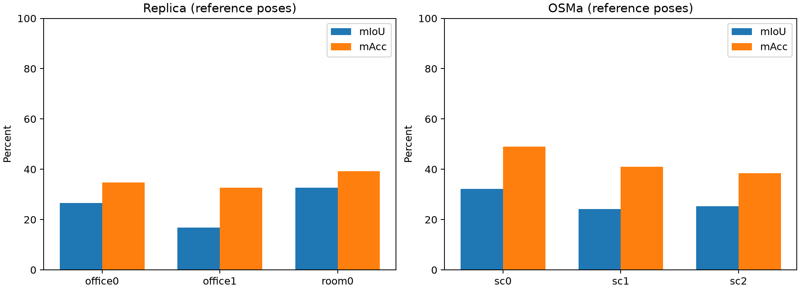

# Semantic_SLAM：阶段性复现与评测

**当前 FAST-LIVO2 与 OVO 分别运行，尚未融合。** 本仓库保存 ROS 2 移植复现、语义基线、受控光照实验，以及可追溯的配置、补丁和结果；没有把参考位姿语义评测当作融合系统的端到端成绩。

## 已完成与待完成

| 工作 | 当前状态 |
|---|---|
| FAST-LIVO2 ROS 2 Humble | 完成构建兼容修复、Retail Street 完整运行与正常退出验证 |
| NTU-VIRAL eee_01 定位核验 | 完整运行；作者示例匹配口径平移 RMSE **2.50 cm**，同口径作者参考轨迹 **2.71 cm**；原始真值插值口径为 2.98 cm / 3.10 cm |
| Replica：office0、office1、room0 | OVO 使用参考位姿及 RGB-D，场景平均 mIoU **25.34%**、mAcc **35.55%** |
| OSMa 发布数据：三个 ReplicaCAD 布局 | baseline 光照，场景平均 mIoU **27.21%**、mAcc **42.82%** |
| OSMa 本地配对重放 | 三场景 × 四光照，共 12 组；本地 baseline mIoU 27.69%，动态光照 24.04%，下降 **3.65 个百分点** |
| M2DGR door_01 / door_02 | **未评测**：官方下载入口持续 HTTP 429，尚未取得有效 bag 与真值 |
| FAST-LIVO2 → OVO 接口 | **未实现**：估计位姿、点云与图像同步、坐标转换、深度投影和端到端验证均待完成 |

语义部分共完成 18 组完整运行（6 组发布数据、12 组配对条件），累计遍历 23,340 RGB 帧。已从保存的逐点预测独立重建混淆矩阵，核对官方指标公式，并检查配对数据的帧数、哈希与共享真值。三场景子集与单种子结果不代表完整数据集或统计显著性。

## 报告与证据

- [阶段一复现方案](FAST-LIVO2_ROS2_复现方案.md)、[工程复现记录](experiments/FAST-LIVO2_复现记录.md)
- [NTU-VIRAL 精度核验](experiments/阶段一_精度核验_eee01_20261020.md)
- [多数据集评测报告](experiments/多数据集评测报告_20261020.md)
- [OSMa 配对光照报告](experiments/OSMa配对光照评测_20261020.md)
- [18 组结果独立核验](experiments/multibench_20261020/final_result_checks.json)、[12 组配对数据核验](experiments/multibench_20261020/paired_data_checks.json)
- [原研究计划与综述](综述报告.md)、[数据集选择依据](experiments/项目最小数据集评测建议_20261020.md)



## 恢复源码与复现

适用环境为 Ubuntu 22.04 / ROS 2 Humble。历史语义环境为 Python 3.11、PyTorch 2.5.1 + CUDA 12.4、RTX 4060 Laptop 8 GiB；完整环境、模型和源码版本记录在 `experiments/` 中。

```bash
git clone https://github.com/dragon99617/Semantic_SLAM.git
cd Semantic_SLAM

# 下载固定提交的第三方源码，检查并应用本项目补丁；不下载数据或模型。
python3 scripts/bootstrap_sources.py --profile all

# ROS 2 依赖安装需要在自己的终端输入 sudo 密码。
bash scripts/01_install_system.sh
bash scripts/02_build.sh
```

语义环境与 ROS 环境隔离：

```bash
bash scripts/setup_semantic_env.sh
```

随后按[复现指南](docs/REPRODUCING.md)准备数据与模型，再运行对应脚本。**这些步骤不是一键完成所有数据授权、下载或模型准备。** 语义脚本默认离线读取已准备好的模型缓存；历史配置内的 `/home/hxy/SLAM_project` 路径仅记录当时环境。

## 仓库包含范围

包含项目脚本、固定版本清单、第三方修复补丁、配置、报告、图表、逐类别指标与小型混淆矩阵。第三方源码通过固定提交恢复，不直接复制到本仓库。

数据集、论文 PDF、模型权重、Python/Conda 环境、ROS 构建目录、大体积地图/检查点及逐点预测留在原本机目录。报告中提到这些本地产物，不代表 GitHub 中附带它们。参见[第三方与数据来源](THIRD_PARTY.md)及[复现指南](docs/REPRODUCING.md)。
