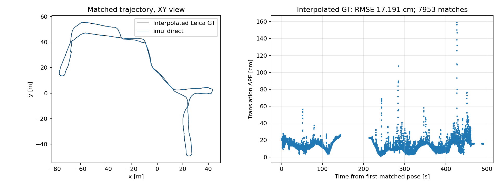

# FusionPortableV2 执行记录

日期：2026-10-21。**最终状态：ugv_transition00 完整回放完成，主算法正常退出，已完成位置真值比对与输入回调核验。** 以下先给最终结果，再保留数据准备、资源调整及故障修复记录。

## 最终运行结果

最终验收对象为 [ugv_transition00_owned_fullres_20261021](fusionportable_v2/runs/ugv_transition00_owned_fullres_20261021/summary.json)，使用修复后的 ROS 2 移植版、1024×768 图像、30 米半边长的滑动几何地图、0.5 倍速回放。**仅运行了 ugv_transition00；ugv_transition01 已下载但未运行。** FAST-LIVO2 与 OVO 仍未连接，本次不包含语义地图端到端评测。

| 项目 | 实测结果 |
|---|---:|
| 保存位姿 | 9,818 |
| 轨迹持续时间 | 490.999964 秒 |
| 估计路径长度 | 467.145 米 |
| 轨迹时间跨度 / 输入扫描起点跨度 | 99.797% |
| 首个位姿距第一帧扫描起点 | 1.035 秒 |
| 最后扫描点距最后位姿 | 0.063 秒 |
| 完整运行用时 | 1024.9 秒（含启动、等待与退出） |
| Mapper 峰值 RSS | 10.381 GiB |
| Mapper 采样到的 swap 峰值 | 0 KiB |
| 输出点云消息 / 跟踪图像（观察者收到） | 19,537 / 4,289 |
| VIO 帧 / 有效检索帧 / 有效更新帧 | 9,816 / 6,299 / 6,178 |

位姿均有限、时间严格递增，四元数模长最大偏差 6.9e-07。bag player 返回 0，主 mapper 日志记录正常退出。停止辅助参数节点时日志出现 SIGINT 的 -2 退出记录；它不是运行期间的 mapper 崩溃。运行期间 `[ERROR]` 数量为 0。

### 发布位置真值比对

均固定尺度为 1、额外时间偏移为 0，对整段有效匹配点执行一次 SE(3) 对齐，不按路段分别对齐。真值文件含单位四元数占位，**不报告姿态精度或全位姿 RPE**。发布文本未明确测量参考点是否已转换，因此直接 IMU 和棱镜杆臂补偿两种解释分别保留，不按较小误差选择权威成绩。

| 匹配口径 | 匹配位姿数 / 全部位姿 | IMU 直接比较 RMSE | 棱镜杆臂补偿 RMSE |
|---|---:|---:|---:|
| evo 最近时间，容差 0.01 秒 | 3,726 / 9,818（37.95%） | 16.743 cm | 16.735 cm |
| 线性插值，左右真值各不超过 0.1 秒 | 7,953 / 9,818（81.00%） | 17.191 cm | 17.179 cm |

最近时间口径 IMU 平移误差平均 13.42 cm、中位数 11.98 cm、最大 1.699 m；插值口径最大 1.593 m。保留了米级误差尖峰，没有删去较差匹配点。真值存在缺口，两种匹配口径覆盖不同，不能把较低 RMSE 当作整段每个时刻的误差，也不能据此宣称论文全数据集精度已复现。

详细依据：[指标 JSON](fusionportable_v2/runs/ugv_transition00_owned_fullres_20261021/accuracy/metrics.json)、[标准 evo 输出](fusionportable_v2/runs/ugv_transition00_owned_fullres_20261021/accuracy/imu_direct_evo_stdout.txt)、[时间覆盖检查](fusionportable_v2/runs/ugv_transition00_owned_fullres_20261021/quality_checks.json)。



### 输入回调核验与产物范围

按 2 微秒容差将实际回调日志与 bag 头时间逐条匹配：IMU 98,400 条中匹配 98,251 条，未匹配 149 条，其中 142 条在首个回调前、7 条在中间、0 条在尾部；图像 9,840 条中匹配 9,828 条，缺少的 12 条均在开头。点云没有逐条回调日志，不能用输出数量证明全部 4,921 帧均被消费。这是日志匹配结果，不是直接的 DDS 丢包计数。**完整回放和转换无遗漏，与运行时消息零遗漏是不同验收项。**

证据：[回调核验](fusionportable_v2/runs/ugv_transition00_owned_fullres_20261021/accuracy/callback_audit.json)、[IMU 中间缺口时间](fusionportable_v2/runs/ugv_transition00_owned_fullres_20261021/accuracy/callback_missing_imu.json)、[开头缺口检查](fusionportable_v2/runs/ugv_transition00_owned_fullres_20261021/accuracy/callback_startup_check.json)、[内存采样](fusionportable_v2/runs/ugv_transition00_owned_fullres_20261021/resource_summary.json)。

[估计轨迹图](fusionportable_v2/runs/ugv_transition00_owned_fullres_20261021/trajectory.png)、[点云预览](fusionportable_v2/runs/ugv_transition00_owned_fullres_20261021/map_preview.png)、[最后跟踪图像](fusionportable_v2/runs/ugv_transition00_owned_fullres_20261021/last_tracking_image.png)已保存。点云产物为每十条输出消息采样约 512 点、按 10 cm 体素去重后得到的 239,024 个点，**不是全量稠密地图**；本次关闭了全量 PCD 累积以控制资源，未做地图真值精度评价。0.5 倍速回放也不用于宣称实时性能。

## 项目内容与目标

依据 `实现路径.txt`、`综述报告.md`、README 和现有实验报告，本项目计划由 FAST-LIVO2 提供估计位姿与几何，OVO 建立开放词汇实例地图，CLIP 检索候选目标，并通过模型复核历史视图。研究重点是连续室内外转场、光照变化下的语义观测可靠性、实例关联和错误恢复。

当前已完成 Retail Street 基础运行、NTU-VIRAL eee_01 平移精度核验，以及 Replica/OSMa 独立语义与光照实验；FAST-LIVO2 与 OVO 尚未连接。本次 FusionPortableV2 工作完成了一条新增定位基线的适配、完整回放和位置参考比较，不代表完成了融合语义系统。

## 首次取数尝试（历史记录）

本节及后面三节保存首次下载受阻时的状态；后续用户补充完整数据并已完成运行，最终结果见文首。

选择 `ugv_transition00`，原因是与连续转场目标相关。官方来源：

- [数据集说明](https://fusionportable.github.io/dataset/fusionportable_v2/)、[下载页](https://fusionportable.github.io/dataset/fusionportable_v2_data/)。
- [官方 Google Drive](https://drive.google.com/drive/folders/1PYhnf3PlY5r0hbyzWDGTUTPxRMl6SYa-)；目标文件 ID：`15ChHaSBrR05EL6X7W1VGSuo_zfebCvIm`，完整压缩包应为 **14,779,194,746 字节**。
- [官方百度网盘备用入口](https://pan.baidu.com/s/1lZwK-TNrCyoyC9oWEs8jUg?pwd=byj8)，提取码 `byj8`。仅确认提取码页面可访问，没有通过此入口取得传感器数据。

已取得 `ugv_transition00_gt.tum`：8,283 条，时间跨度 507.089987 秒，SHA-256 为 `845226f8715ff83c13967e594a858f25fef0db0ed8179f91b5a18cacac07c47c`。文件位于 `datasets/FusionPortableV2/original/`。四元数全部为单位四元数，不能据此评测姿态；计分前仍须核实发布真值的测量参考点及杆臂处理。

完整下载和小段下载均实际尝试过。`ugv_transition00`、`ugv_transition01`、`legged_transition00`、`handheld_room00` 的完整下载端返回 HTTP 200 的 HTML，标题为 **Google Drive - Quota exceeded**。HTTP 成功状态不表示数据下载成功。个别字节范围请求有效，但最终仅保留 3 个有效分片、共 6,291,456 字节，远不足以解压运行；已经停止下载任务。

错误页面归档为 `datasets/FusionPortableV2/original/download_quota_error.html`，没有保留成 `.7z` 冒充数据。结构化状态见 [preparation_status.json](fusionportable_v2/preparation_status.json)。项目数据目录及 Windows 的 Downloads、BaiduNetdiskDownload 中未找到可用的 FusionPortableV2 bag。

## 初始候选配置（历史记录）

UGV 使用官方 `20230426_calib/calib`，固定 [calibration_files](https://github.com/fusionportable/calibration_files) 提交 `20f1b4d867dfedcdd1d4c81578f82f65a85e4ea2`。下载的三个 YAML 副本保存在 [config](fusionportable_v2/config/)。

使用官方工具 `src/cfg/dataset/cfg_ugv.py` 核对话题定义：Ouster `/os_cloud_node/points`、STIM300 `/stim300/imu/data_raw`、左相机 `/stereo/frame_left/image_raw/compressed`。候选参数面向将来解码并重命名为 `/left_camera/image` 的 ROS 2 原始图像输入；这一步转换尚未执行。

配置生成脚本按照官方 `IntrinsicExtrinsicLoader` 与 `TFGraph` 的父子坐标变换约定，对 YAML 中的 `T_lidar_body`、`T_lidar_camera` 求逆，得到 FAST-LIVO2 使用的 IMU←LiDAR、Camera←LiDAR。使用该平台的相机内参及畸变，128 线 Ouster 预处理参数；其余估计器参数以社区 NTU 配置为初始值，尚未调参或验证精度。

官方数据说明指出点云消息时间是扫描末尾，而本地算法将其当作扫描起点。候选配置暂用 `lidar_time_offset=-0.1` 对应标称 10 Hz；**必须取得 bag 后检查逐点 `t` 字段、扫描时长和字段类型，再决定实际时间处理，当前值不是已验证结论。** 相机采用标定的初始固定偏移 `-0.013618216766727708` 秒；[FAST-LIVO2 作者在 issue #234 的反馈](https://github.com/hku-mars/FAST-LIVO2/issues/234)指出该数据可能存在逐帧变化的相机/LiDAR 时间差，不能把固定偏移视为解决了同步问题。

## 最初的启动预检查（历史记录）

执行了：

```bash
third_party/accuracy_venv/bin/python scripts/prepare_fusionportable_config.py
source scripts/env.sh
ROS_DOMAIN_ID=72 ros2 launch fast_livo mapping_aviz.launch.py \
  use_rviz:=False use_compressed_image:=False \
  avia_params_file:="$PWD/experiments/fusionportable_v2/config/fusionportable_v2.yaml" \
  camera_params_file:="$PWD/experiments/fusionportable_v2/config/camera.yaml"
```

自动启动检查实际加载了 mapper 和 camera 参数，分别转储归档，然后对 mapper 发送 SIGINT；日志记录 `process has finished cleanly`。结果见 [preflight/summary.json](fusionportable_v2/preflight/summary.json) 与两份参数转储。这里只验证启动和参数加载，没有播放 bag，也没有验证外参投影、传感器初始化或轨迹质量。

两个新增 Python 脚本通过 `py_compile`。下载器检查 7z 文件头、HTTP 206、Content-Range 和每段长度，遇到配额 HTML 会失败退出，并保留已完成分片供重试。实际单线程重试也因无效范围响应失败，未产生完整 `.7z`。为后续解压在独立的 `accuracy_venv` 安装了 `py7zr==1.1.4`；未更改 ROS 系统依赖。

## 当时的续跑方案（历史记录）

下载恢复后可重试：

```bash
python3 scripts/download_fusionportable.py --workers 4
```

或将已有的官方 `.bag` / `.7z` 放入 `datasets/FusionPortableV2/original/`。随后仍需完成完整解压与 CRC 核验、实际话题及逐点时间审计、ROS 1→ROS 2 转换与图像解码、短段传感器检查、整段回放和传感器时间覆盖验证。只有上述步骤完成、节点正常退出且真值参考点确认后才能计算平移精度。

**早先下载受阻阶段的状态：仅完成启动检查，尚未回放。该状态已被后续完整运行更新。**

## 用户补充数据后的执行

22:27 起，项目根目录发现用户下载的 `ugv_transition00.7z`（14,779,194,746 字节）和 `ugv_transition01.7z`（11,460,922,572 字节），SHA-256 记录在 `fusionportable_v2/downloaded_archives.sha256`。本次按此前计划先运行 `ugv_transition00`；`01` 尚未运行。

初步实际检查确认：Ouster 点字段与当前预处理器兼容，128×1024 点/帧；左图像为 1024×768 JPEG；STIM300 加速度静止模长约 9.76 m/s²。bag 自带 TF 的 IMU←LiDAR 与候选配置的平移差约 0.36 微米、旋转差约 0.000153 度，差异来自标定文本舍入；首帧投影叠加保存在 `first_projection.jpg`。

转换器保留点云数据缓冲区，只将点云头时间由扫描末尾改为 `原时间 - max(t)`，逐帧记录改动；因此运行配置的 `lidar_time_offset` 改为 **0**，避免重复减去 0.1 秒。JPEG 解码为 BGR8，保持图像和 IMU 头时间以及所有 bag 记录时间；不向算法提供真值。逐条核对序列化前后的目标内容，完整转换结束后另存核验记录。

先对开头 30 秒的原始记录建立独立诊断 bag。第一次启动因 ROS 参数服务发现超时而结束，尚未播放数据；增加参数发现重试后，`diagnostic_run_30s_v2` 完整回放并正常退出，保存 590 个位姿、点云采样和跟踪图像。该结果明确标记 `diagnostic_completed`，不进入完整序列成绩。

发布真值的位置与官方工具仓库 `paper_plot/resampled/ugv_transition00_resampled.txt` 完全相同，时间整体早 0.02 秒，与官方相关性脚本列出的偏移一致。本项目不再次拟合真值时间。发布文本没有明确测量参考点元数据，因此后续平移比较会同时保留直接 IMU 与官方杆臂补偿后的棱镜两种解释，不按更低误差选择口径；不评价占位单位四元数的姿态。

### 完整数据转换与内存适配

完整解压 CRC 通过，原始 bag 为 42,657,427,199 字节，SHA-256 为 `779562c867b1426cc7953dd47baef49c258b10d9b78a2c11979437d6817eee0f`。转换保留 4,921 帧点云、9,840 帧左图像、98,400 条 STIM300 IMU，共 113,161 条记录；数量与源数据一致，逐条内容及 SQLite 完整性检查通过。所有三类头时间均没有重复或倒退。扫描时长为 0.0993635～0.10045569 秒，逐帧补偿记录保存在派生 bag 目录。

第一次完整回放使用原分辨率及关闭滑动地图的初始配置，在约 175 秒传感器时间处因内存持续增长到超过 5 GB 而主动中断；没有观察到系统 OOM。中断时 mapper 触发 ROS context 无效异常，未正常退出，`ugv_transition00_full_20261021` 标为失败，不进入整段计分。没有把该部分轨迹当作完整结果。

进一步检查源码发现视觉地图观测持有整幅参考图像，且初始几何地图不滑动。为适应这台 7.6 GiB RAM 主机，改用算法已有的相机缩放和局部地图设置：

- `camera.scale=0.5`，实际视觉分辨率 512×384；算法同步缩放内参，原始数据和派生 bag 中的 RGB 分辨率不变。
- `local_map.map_sliding_en=true`，`half_map_size=60`。该参数按 **0.5 米根体素的数量**解释，因此半边长约 30 米，局部立方体边长约 60 米；不是 60 米半径。
- `sliding_thresh=2.0` 米；日志确认在移动过程中清理远处体素。

新的 30 秒诊断运行 `diagnostic_run_memory_profile` 完成并正常退出；随后从头启动 `ugv_transition00_memory_profile_20261021`。这是带资源适配的初始配置，不能描述为完整复现作者某个数据集专用参数或算法精度提升。

### 图像生命周期错误定位与修复

半分辨率完整尝试在约 166 秒传感器时间发生 SIGSEGV，当时节点峰值 RSS 约 1.55 GiB，没有 swap 占用，不能归因于内存耗尽。GDB 再次回放时在 OpenCV `cv::resize` 的工作线程捕获 SIGSEGV，主线程调用链为 `VIOManager::processFrame → cv::resize`。该次调试不是完整序列结果。

检查 `LIVMapper::getImageFromMsg` 及回调缓存链发现：`cv_bridge::toCvShare(img_msg, "bgr8")->image` 在原消息已经是 BGR8 时直接包装 ROS 消息的像素数组。函数只返回 `cv::Mat`，没有保留 `CvImage`/ROS 消息 owner；回调结束后缓存的像素指针可能失效。先前 mono8 等需转换的输入会重新分配图像，因此不一定触发同样的问题。

修复改为 `cv_bridge::toCvCopy(img_msg, "bgr8")->image`，确保后续异步处理使用自行持有的像素缓冲区。专项 C++ 检查 `image_lifetime_probe.cpp` 验证了旧共享 Mat 不保留 ROS owner、复制后的 Mat 在消息释放及内存重用后仍能正确缩放。修改已重新构建，并加入 `experiments/patches/FAST-LIVO2.patch`；补丁反向应用检查通过，校验值同步到 `experiments/local_patches.json`。静态检查时发现的参考特征未初始化风险没有被证实是这次崩溃原因，本次未修改那部分算法。

用户随后将 WSL 内存扩大到约 **15 GiB，swap 4 GiB**，重启后确认原运行进程已结束。修复后的整段运行改用 **原分辨率 1024×768、scale=1.0**，保留半边长约 30 米的滑动几何地图，从头执行 `ugv_transition00_owned_fullres_20261021`。当前以该次运行作为完整验收对象，其他失败/短段记录不计分。
