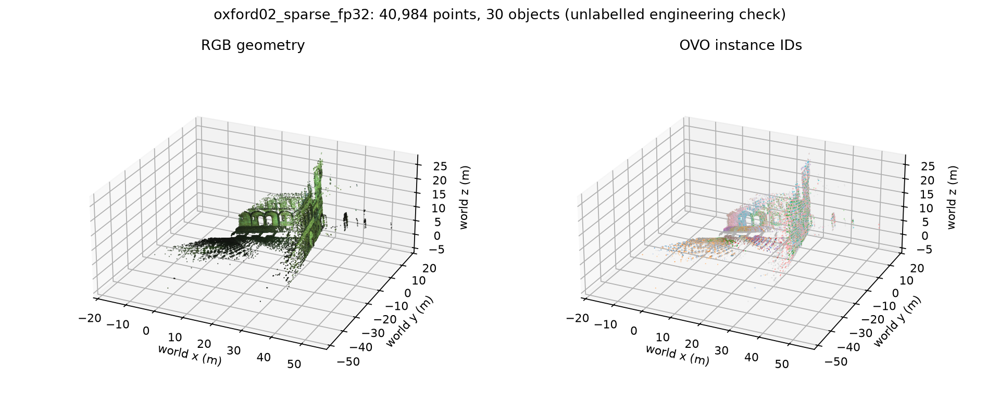
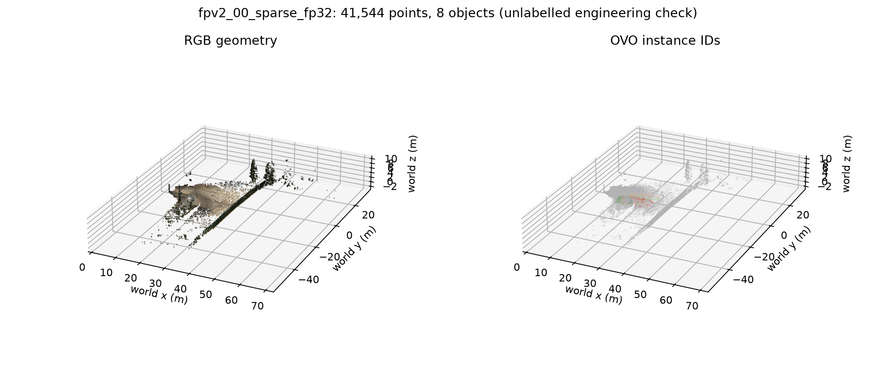

# 第二阶段：FAST-LIVO2 → OVO 首步集成验证

生成时间：2026-10-24T00:35:25.405518+08:00。

**第一阶段复核通过，第二阶段的离线短段连接已验证。第二阶段整体尚未验收。**

后续进展：Oxford02/05 已完成全序列和 13 个转场窗口的工程验收，见[完整记录](full/README.md)。本页保留短段结果；独立语义标注与精度验收仍待完成。

第一阶段 238 个冻结文件、源码提交及 OVO 补丁再次核对一致，12 次几何运行的紧凑产物与 30 份评分 CSV 保持原样。M2DGR 下载不可用的例外继续保留。见 [第一阶段复核](phase1_recheck_final.json)。

| 真实片段（各 16 s） | 原始 / 接入 RGB 帧 | 最大同步残差 ns | 平均有效深度 | 地图点 | 对象 | 已赋对象 ID 的点 | 有新点的建图更新 |
|---|---:|---:|---:|---:|---:|---:|---:|
| Oxford02 / fisheye | 319 / 158 | 210 | 1.38% | 40,984 | 30 | 16,173 (39.46%) | 32 |
| FPV2 00 / pinhole | 320 / 159 | 253 | 0.71% | 41,544 | 8 | 2,130 (5.13%) | 32 |

两段都精确接收了切片内全部原始传感器消息，mapper 正常退出；未接入图像逐帧记录原因，主要是没有同刻非空前视点云，另有初始化/尾部无位姿的帧。没有用邻帧点云或插值位姿填补。整数 ns 同步只允许 2 µs 的浮点时间输出量化容差，FPV2 固定使用相机→IMU 时移 −13,618,217 ns。

`T_cam_imu = T_cam_lidar · inverse(T_imu_lidar)`，`T_world_cam = T_world_imu · inverse(T_cam_imu)`。使用 LIO 更新后、同帧 VIO 更新前的 IMU 估计位姿。冻结 mapper 的点坐标也在该状态下生成，后续 VIO 发布做视场过滤和着色；适配器使用原始图像，不使用叠画 `/rgb_img`。鱼眼/针孔 RGB 先统一去畸变到固定新 K；深度为同一相机坐标系的 z 值（米），同像素取最近点，零为无观测，保留有效掩膜。

逐点用独立齐次逆变换和 OpenCV 投影复核，最近像素误差≤0.5 px，z 数值误差<2 µm。这是数值接口检查，不代表实际标定或三维空间精度达到微米。原生 TUM、ROS 位姿与 OVO 保存的 c2w 均已比对。

## 稀疏输入兼容

沿用 SAM2.1 large、SigLIP-384、发布融合权重、FP16/分批资源设置与全部语义阈值。第三方源码与冻结估计器未修改。仅在本项目适配器中显式选择两个 `valid_mask` 策略：

1. 原深度边缘滤波把缺测零值参与高斯平滑，抽查帧的有效深度全部被剔除。适配为按有效支持归一化平滑；无效像素仍为零，不补深度，核大小、sigma 和原阈值不变。
2. 原建图的重复点邻域抑制把无深度像素也视作已匹配区域，导致地图停在首帧。适配为只围绕实际有深度且匹配已有地图的像素抑制新点；核大小和建图频率不变。

另外，作者在语义推理外层使用 BF16 autocast，连带世界点→相机投影及 5 cm 深度匹配也被降精度；真实片段首帧自匹配中，FPV2 的 1096 个 FP32 匹配在 BF16 下只剩 228 个，Oxford 为 632→239。适配器仅将对象几何关联固定为 FP32，模型推理精度保留。见 [精度复核](geometry_precision_check.json)。这项数值适配也单独披露，不归因于新语义算法。

两项策略在完整正深度输入上均与原实现逐元素一致；空洞、非有限值、边缘和稀疏新点行为另有测试。6 项几何测试与 6 项稀疏兼容测试均通过。诊断过程及未通过的尝试见 [诊断记录](diagnostics.md)。这些是已披露的输入兼容改动，不能把集成结果称为完全未改动的原方法分数。

## 可审阅产物

- Oxford02 / fisheye：[运行结果](runs/oxford02_sparse_fp32/runtime.json)、[逐帧新增点](runs/oxford02_sparse_fp32/mapping_trace.json)、[地图重载及文本查询](runs/oxford02_sparse_fp32/map_checks.json)、[投影帧审计](inputs/oxford02_16s/frame_audit.csv)。


- FPV2 00 / pinhole：[运行结果](runs/fpv2_00_sparse_fp32/runtime.json)、[逐帧新增点](runs/fpv2_00_sparse_fp32/mapping_trace.json)、[地图重载及文本查询](runs/fpv2_00_sparse_fp32/map_checks.json)、[投影帧审计](pipeline_fpv2_00_r2/input/frame_audit.csv)。


检查点重载后，所有地图点、对象描述符和文本查询分数均为有限值，对象 ID 可解析，地图在多帧上持续扩展。文本查询只证明功能可用，其候选词排名不作为语义准确率。

语义覆盖仍有限：表中赋对象 ID 的比例只针对本次输出点云，既不是整个场景的覆盖率，也不证明对象 ID 正确。尤其 FPV2 的稀疏输入与保留的原关联阈值限制了可赋语义的点；后续需在冻结条件下继续诊断，不能通过本次短段检查宣称语义质量达标。

## 复跑与下一步

```bash
bash scripts/run_livo_ovo_pipeline.sh \
  experiments/phase1_20261022/oxford02.json \
  experiments/phase2_20261024/new_oxford_test 16
```

输出目录必须不存在；最后一个参数为从包开头截取的秒数，0 表示全包。系统 ROS Python 负责采集/投影，隔离 semantic_venv 负责 OVO。原始数据、NPZ 帧和检查点保留本机，紧凑审计与预览随项目保存。

下一步是冻结本适配器，在完整序列和已标注转场窗口验收覆盖与资源占用，再做 Oxford 可用参考几何/估计几何配对。参考与估计几何必须使用同样的掩膜/FP32 适配，第一阶段未适配的 OVO 分数不能直接作为这批集成结果的公平对照。当前仅完成两种相机的短段接口验证，尚未完成全序列、转场、实时在线节点或语义/实例精度验收；未加入可靠性门控、恢复或正式消融模块。

机器可读验收与源码/产物哈希见 [final_acceptance.json](final_acceptance.json)。
