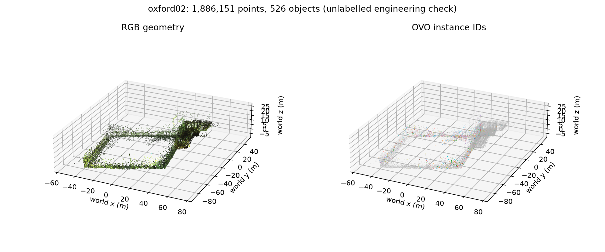
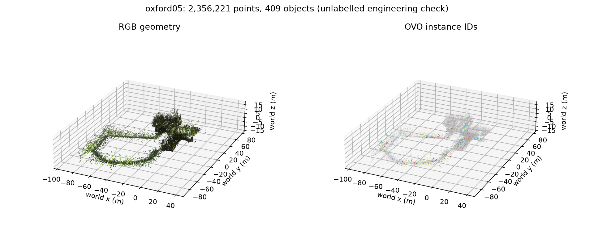

# Oxford 全序列及转场验收

更新：2026-10-24T01:52:57.658222+08:00。

**两条完整序列的工程验收通过；转场语义精度等待独立标注，尚未判定通过。**

第一阶段 238 个冻结文件、源码和模型版本在本次运行后再次复核一致，见 [phase1_recheck_after_full.json](phase1_recheck_after_full.json)。

运行覆盖当前已准备的 Oxford Christ Church 02、05 全部输入，分别约 592 s、800 s；不是 Oxford 全部 24 条序列。冻结估计器、相机与回放速率 0.5 沿用上一阶段。

| 序列 | 原始 RGB / 接入 RGB-D | IMU 位姿 | 地图点 | 对象 | 已赋对象 ID 的点 | 最近邻 APE RMSE m | 插值 APE RMSE m |
|---|---:|---:|---:|---:|---:|---:|---:|
| oxford02 | 11775 / 5935 | 11763 | 1,886,151 | 526 | 177,560 | 0.29768 | 0.29766 |
| oxford05 | 3961 / 3959 | 3959 | 2,356,221 | 409 | 164,722 | 0.15277 | 0.15120 |

所有输入回调多重集合、同刻同步、投影数值、原生/ROS 位姿、完整 OVO 帧遍历与重载地图均检查。地图多帧扩展；各转场中心窗口均有语义更新。未接入帧及截断/重叠窗口有单独记录，不能用输入接收完整替代算法更新覆盖。

APE/RPE 只使用真实 6DoF base 参考与一次全程 SE(3) 对齐，尺度固定 1，不搜索时移，不逐窗口重配准。Oxford02 最后部分无参考轨迹的限制继续保留；几何误差不等于语义精度。

| 事件 | 类型 | 前 / 中 / 后接入 RGB-D 帧 | 前 / 中 / 后语义更新 | 语义精度 |
|---|---|---:|---:|---|
| oxford02_t1 | outdoor → indoor | 200 / 201 / 200 | 20 / 20 / 20 | 待独立标注 |
| oxford02_t2 | indoor → outdoor | 200 / 200 / 201 | 20 / 20 / 20 | 待独立标注 |
| oxford02_t3 | outdoor → covered_passage | 200 / 200 / 200 | 20 / 20 / 20 | 待独立标注 |
| oxford02_t4 | covered_passage → outdoor | 201 / 203 / 201 | 20 / 21 / 20 | 待独立标注 |
| oxford02_t5 | outdoor → indoor | 200 / 201 / 201 | 20 / 20 / 20 | 待独立标注 |
| oxford02_t6 | indoor → outdoor | 201 / 201 / 200 | 20 / 20 / 20 | 待独立标注 |
| oxford02_t7 | outdoor → indoor | 200 / 200 / 114 | 20 / 20 / 11 | 待独立标注 |
| oxford05_t1 | indoor → outdoor | 100 / 101 / 100 | 10 / 10 / 10 | 待独立标注 |
| oxford05_t2 | outdoor → indoor | 100 / 99 / 96 | 10 / 10 / 10 | 待独立标注 |
| oxford05_t3 | indoor → covered_passage | 98 / 101 / 100 | 10 / 10 / 10 | 待独立标注 |
| oxford05_t4 | covered_passage → outdoor | 99 / 101 / 99 | 10 / 10 / 10 | 待独立标注 |
| oxford05_t5 | outdoor → indoor | 100 / 100 / 96 | 10 / 10 / 8 | 待独立标注 |
| oxford05_t6 | indoor → outdoor | 99 / 98 / 57 | 9 / 10 / 5 | 待独立标注 |

完整稀疏语义地图复用全程轨迹对齐后，与 5 cm TLS 参考逐点比较，不做额外地图 ICP，也不裁掉大距离点：

- oxford02：中位距离 0.0733 m，95 分位 0.7014 m，80.82% 的输出点距参考≤0.2 m。
- oxford05：中位距离 0.0581 m，95 分位 0.2562 m，91.57% 的输出点距参考≤0.2 m。

这些是观测地图到参考表面的几何距离，受参考覆盖、遮挡和动态物体影响，不代表全场景完整性或语义准确率。

## 独立标注与计分

[标注包 ZIP](annotations/oxford_transitions_v1.zip) 含 114 张独立抽样、去重后的去畸变图像，覆盖 13 个事件和前/中/后固定窗口。117 个请求锚点中有 2 个被序列尾部截断，另有 1 个重复采样图像已合并。包含 15 类定义、有效区域、空模板和 tasks.csv；没有把预测或空模板当作真值。

请按[标注说明](annotations/oxford_transitions_v1/README.md)完成独立标注与复核。预测存放在 runs/*/transition_predictions，未放入盲标注包。渲染只使用采样时刻之前的地图及当时已有描述符，不用全序列末尾的地图覆盖过去；保留原 OVO 的延迟队列。没有完成的描述符或位姿时输出未知，不用未来信息补齐。稀疏渲染不能解决未采样遮挡。

两条序列均保留 segment_every=10、kf_queue_delay=10；它们实际输入频率不同，因此真实时间上的语义更新频率和描述符延迟不同。队列参数按关键帧计，不按固定秒数解释，也未为改善转场结果调参。

标注完成后：

```bash
python3 scripts/score_oxford_transition_annotations.py \
  experiments/phase2_20261024/full/annotations/oxford_transitions_v1 \
  --predictions experiments/phase2_20261024/full/runs/oxford02/transition_predictions \
                experiments/phase2_20261024/full/runs/oxford05/transition_predictions \
  --output experiments/phase2_20261024/full/semantic_evaluation.json --require-complete
```

计分输出逐类 IoU、mIoU、像素准确率、未知预测比例、条件准确率及每事件/每窗口结果。未知预测计入漏检，汇总按唯一图像去重；重叠事件不能视为独立样本。还没有约定准确率通过阈值，因此即使之后有标注，脚本也只报告测量，不擅自给出质量通过结论。

## 产物与边界

- oxford02：[全程审计](runs/oxford02/full_audit.json)、[地图检查](runs/oxford02/map_checks.json)、[进度与资源](runs/oxford02/resources.json)、[完整几何评分](captures/oxford02_full_r1/accuracy/metrics.json)。


- oxford05：[全程审计](runs/oxford05/full_audit.json)、[地图检查](runs/oxford05/map_checks.json)、[进度与资源](runs/oxford05/resources.json)、[完整几何评分](captures/oxford05_full_r1/accuracy/metrics.json)。


公开标注查找结果见 [annotation_search.md](annotation_search.md)，原始运行、数据帧和检查点保留本机。全序列工程验收、当前可见语义覆盖、转场语义准确率分别报告。

本次只新增只读监测与因果预测导出；姿态比较支持 q 与 −q 等价，避免完整旋转时误报。没有改变估计器、语义阈值、模型权重或上一轮验证的两项稀疏掩膜/FP32 几何处理。只读导出前后的短段结果一致，见 [instrumentation_check.json](instrumentation_check.json)。

首轮控制器在写审计 JSON 时遇到 NumPy 布尔值序列化错误，修复报告写入后恢复控制器，复用已经成功的建图与采集。保留原异常日志与控制器状态；未重跑或改变 Oxford02 语义地图。报告/控制器的非算法修订见 [non_algorithmic_report_fix.json](non_algorithmic_report_fix.json)。

机器可读状态：[final_acceptance.json](final_acceptance.json)、[semantic_evaluation.json](semantic_evaluation.json)。
