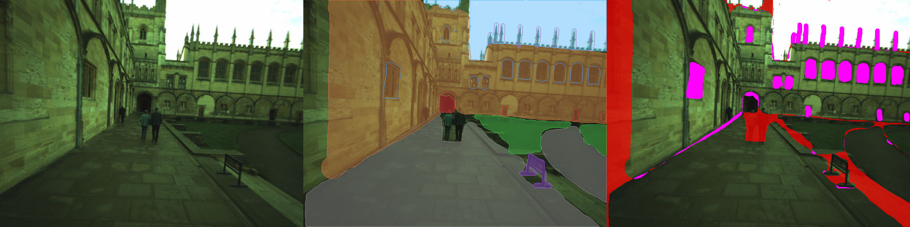
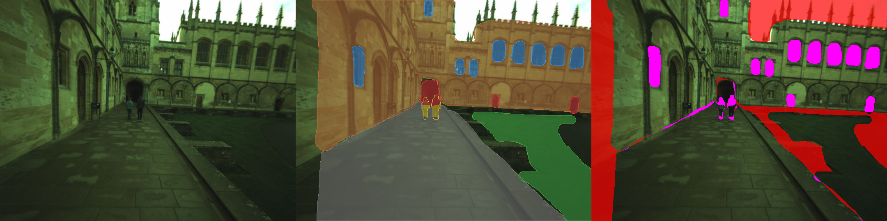
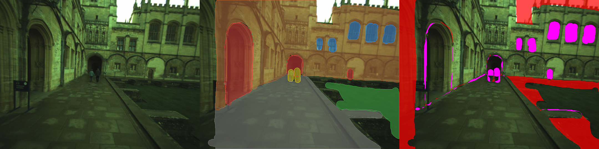

# test1 三张试标检查

**结论：文件可解析，主要区域轮廓可以复用；需修正部分对象含义、覆盖与层级，尚未导入正式真值或计分。**

本检查只参考原图和人工导出，不参考 OVO 预测。原始 test1 文件未改动。

| 图片 | 已覆盖像素比例 | 未标像素比例 | 跨形状重叠像素比例 |
|---|---:|---:|---:|
| 1：oxford02_1710754317901738028.png | 88.65% | 11.35% | 5.10% |
| 2：oxford02_1710754322901634345.png | 82.13% | 17.87% | 4.30% |
| 3：oxford02_1710754327901552945.png | 83.17% | 16.83% | 4.04% |

比例只是标注结构检查，不是准确率；合法前景/背景层也可以重叠。三张均为 720×540，图像 SHA 与原始标注包完全一致，全部 CVAT RLE 掩膜的长度与边界合法。所有形状 z_order=0，且均没有描述属性。

## 优先修改

1. 第一张前景的黑色落地告示牌标成了 railing_fence。应按物体含义改为 sign；开放词汇可描述为“路边黑色落地告示牌 / black freestanding information sign”。不要把告示牌内透出的地面一起当牌面。
2. 中央拱形通道入口在三张中被标为 door。能看到门扇时才把门扇标成 door；对于可通行的拱形开口，明确标注的是“石拱框”还是“拱形通道入口”，并使用相应的自由文本描述。行人应从后方入口/地面区域中排除。第三张左侧入口也需要核对这一点。
3. 墙面掩膜包含了已画出的窗户：三张分别有 12,413、13,492、10,238 个窗户像素同时落入墙面。窗口可以作为墙前的独立层，最终转为互斥语义掩膜时必须明确窗/门/人优先于背景墙面；不用重画整个墙，只需正确表达层级。第一张 sky 与 ceiling_roof 也重叠 4,017 像素，天空要避开建筑尖饰和屋顶实体。
4. 第二、三张天空基本未覆盖，三张左侧墙边、草坪边沿及部分人物仍有遗漏。可辨认的区域补齐；实在无法判断的地方明确使用 ignore。第一张两名行人没有独立的人体掩膜。第二、三张已有的人体掩膜应保留；当前按 XML 顺序合成时，第二张部分人体被后画的入口/地面覆盖，先调整层级，不要仅凭合成预览把已有上身再重画一遍。

## 开放词汇评测怎么接

现有 ground_floor/window/person 等标签可作为粗类别保留，不必废弃。若要验证“某一扇窗”“左边的行人”等对象级或细粒度文本查询，需要把对应目标拆成独立区域，给每个区域增加 description 文本属性；仅有类别名称不足以定义这些查询的真值。

一张 window 掩膜目前合并了多扇窗，一张 person 掩膜合并了两个人。如果查询目标就是“所有窗户”，合并掩膜可以用；若查询单独某扇窗或某个人则应拆分。成组区域可保留，但描述必须明确例如“一排拱形窗户”，评价范围也限定为组级查询。

可从这三张先选几个目标完善描述，例如：“路边黑色落地告示牌”“远处中央的拱形通道入口”“右侧二层一排拱形窗户”“画面中央左侧的行人”。不能可靠辨认的材质、人物身份或标牌文字不推测。

三张均为同一个转场之前的室外样本；后续再补一张门口和一张室内图，核对遮挡、过曝与欠曝的处理规则后再批量标注。

## 检查图

每张检查图：左为原图，中为按 XML 顺序合成的示意，右侧红色表示未覆盖、紫色表示形状重叠。中图仅用于暴露层级歧义，不代表最终转换优先级。

