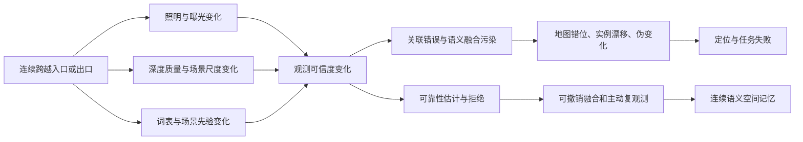
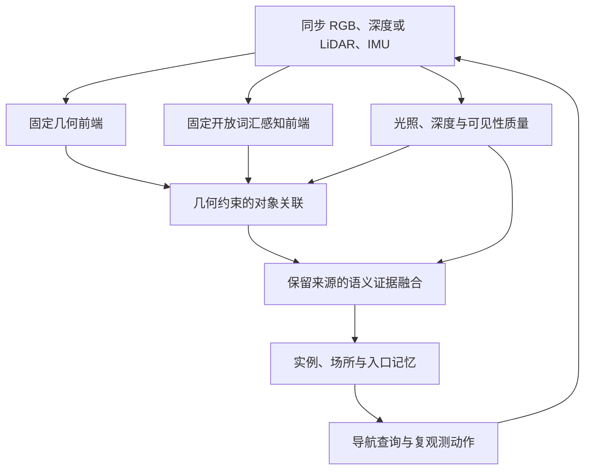

语义 SLAM 的主线已经从“给几何地图加类别”延伸到对象联合估计、开放词汇空间记忆、时空变化维护和任务驱动感知。动态物体剔除、固定类别语义叠加、在室内标准数据上更换表示或分割器，增量贡献较拥挤；开放世界的长期关联、可靠性校准、跨尺度连续地图和真实转场恢复仍值得研究。这里的拥挤程度是基于代表性方法谱系的定性判断，不是论文数量统计。

针对室内外连续空间、具身智能导航的方向，我认为最值得围绕的研究问题是：机器人连续穿越室内外时，如何区分真实世界变化与光照、深度和语义域变化造成的观测失真，并维持可用于定位、关联和导航的语义空间记忆。曝光估计将同时作为观测模型的一部分。

与此话题最接近的研究是Wang 等 2022 年明确做过的连续室内→室外语义 LiDAR 重建；但其环境识别与子图调整不能等同于开放词汇跨域一致性、强光深度退化和转场任务恢复已得到完整验证。[R05]

下面我将在语义slam这个领域做较为完整的总结。

## 1. 范围、术语与评价规则

### 1.1 纳入范围

以语义参与定位或建图的机器人系统为核心，纳入对象 SLAM、语义回环、概率融合、开放词汇在线地图、神经语义场、3D 场景图、长期维护、多模态和主动感知。纯分割、离线特征场、深度基础模型与导航策略作为邻近技术列出，不能直接计作完整语义 SLAM 系统。经典工作用于建立谱系，2024—2026 年工作用于追踪近期进展。

本文主要依据三类资源：原始论文及作者公开全文；正式会议/期刊记录；官方代码与数据说明。综述用于检索导航，不以综述中的“首次”“空白”代替原始证据。[R01–R03,R46]

### 1.2 五个维度分别评价

**内容，研究深度，近期活跃度，路线拥挤度，前景**

### 1.3 实验与证据标签

全文证据记为 **F**；

原始摘要/书目/官方项目说明记为 **M**；

本文建议记为 **H**。

连续性标签：**C1**＝明确同一序列连续跨越边界；**C2**＝数据或系统有混合环境线索，但本轮未确认具体连续序列与方法评测对应；**C0**＝这里核实的实验只支持单域或分开评测；**C?**＝未核实。**C0/C?** 不等于论文所有版本永远没有该能力。

## 2. 子方向概述

下表是选题用的定性地图。拥挤度针对“常规切入点”，前景针对尚有区分度的问题；同一方向可以既很活跃，又有研究空间。参考编号在文末对应原始链接。

| 编号 | 子方向与研究内容 | 研究深度 | 近期活跃度 | 常规路线拥挤度 | 发展现状、可研究增量与限制 | 代表依据 |
|---|---|---|---|---|---|---|
| A1 | 固定类别体素、TSDF、surfel 语义地图 | 系统验证较丰富 | 稳定 | 高 | 逐帧分割再投影融合已成熟；相关观测、闭环修正和失校准仍有空间 | R09,R47,R52 |
| A2 | 对象级地图与实例身份 | 方法体系形成 | 活跃 | 中高 | 从参数化对象到对象重建；遮挡、重访、误合并和未知对象更有价值 | R10,R49–R51,R22 |
| A3 | 神经隐式语义场 | 方法体系形成 | 活跃 | 中高 | 几何/颜色/语义共同表示已出现；全局一致性、远近尺度和部署成本仍受限 | R11 |
| A4 | 语义/实例 3D Gaussian SLAM | 方法体系形成 | 很活跃 | 中高 | 室内表示与损失设计竞争密集；长程跨域、真实退化和地图维护更值得投入 | R04,R12,R34,R58,R59,R64 |
| A5 | 开放词汇特征地图与语言场 | 方法体系形成 | 很活跃 | 中高 | 可查询不等于可靠未知类识别；需维护跨视角特征、词表与概率一致性 | R13,R14,R21,R53,R54,R57 |
| A6 | 层次 3D 场景图与度量拓扑记忆 | 方法体系形成 | 很活跃 | 中 | 对象—房间—建筑图已形成；门口跨层级连接、闭环后关系修正与任务记忆仍有空间 | R15,R16,R55,R62 |
| B1 | 闭集分割/检测辅助建图 | 系统验证较丰富 | 稳定 | 高 | 单换检测器或堆叠掩码难建立新贡献；需证明估计或地图维护的机制改进 | R47,R48,R60 |
| B2 | 开放词汇、开集与未知类别拒识 | 方法体系形成 | 很活跃 | 中 | 开放词汇不保证分布外可靠；转场时过度自信、词表不兼容值得研究 | R12,R13,R21,R57,R65 |
| B3 | 跨帧/跨视角语义一致性融合 | 方法体系形成 | 活跃 | 中 | 从投票到学习聚合和概率融合；同源相关性与条件变化应显式考虑 | R09,R20,R21,R57,R65 |
| B4 | 跨域语义适应与词表/本体对齐 | 基础形成 | 活跃 | 证据不足 | 邻近分割领域积累多；SLAM 内在线更新、未知类保护和防遗忘证据需专项扩检 | R13,R16,R17,R21 |
| B5 | 空间关系、可供性与语言指代落地 | 方法体系形成 | 很活跃 | 中 | 对象关系和语言查询已有多种实现；跨边界关系保持、歧义拒绝与物理可通行性更有价值 | R03,R14,R54,R55,R63 |
| C1 | 对象/语义概率数据关联 | 方法体系形成 | 活跃 | 中 | 离散关联和连续位姿联合推断有先例；关联风险与拒绝机制仍重要 | R10,R22,R23 |
| C2 | 语义辅助回环与全局重定位 | 系统验证较丰富 | 活跃 | 中高 | 语义和几何互补；视觉别名、反向视角、跨域误回环仍未简单解决 | R22,R28,R30 |
| C3 | 几何—语义紧耦合与联合优化 | 方法体系形成 | 活跃 | 中 | “加入语义损失”已有大量先例；应证明信息增量、误差传播和错误语义下稳定性 | R10,R11,R23,R59 |
| C4 | 可观测性、可辨识性和估计一致性 | 基础形成 | 稳定 | 较低 | 理论门槛高；信息相关、退化和物理参数混淆需给条件及反例 | R23,R35–R37 |
| D1 | 动态区域识别与剔除 | 系统验证较丰富 | 活跃 | 高 | 语义+几何运动检查是经典路线；只在 TUM 动态序列改善 ATE 区分度有限 | R60,R72 |
| D2 | 相机与动态对象联合跟踪/建图 | 方法体系形成 | 活跃 | 中高 | 保留动态对象而非删除更复杂；遮挡重现、交互和长程身份仍有空间 | R48,R61,R24 |
| D3 | 长期变化检测与对象生命周期 | 方法体系形成 | 很活跃 | 中 | 已有存在性、变化与时空地图；区分观测失真和真实变化尤其适合转场 | R24,R25,R62 |
| D4 | 可移动、铰接和可供性地图 | 基础形成 | 活跃 | 证据不足 | 门与入口连接导航和交互；需几何、状态及任务联合真值，不能只靠语言推理 | R03,R14,R55 |
| E1 | 室内外连续语义地图与边界建模 | 基础形成 | 活跃 | 中 | 已有真实转场语义重建；统一词表、实例记忆和转场专项量化尚需补强 | R05,R40,R63 |
| E2 | 光照、曝光和外观条件鲁棒性 | 方法体系形成 | 活跃 | 中 | 几何定位与语义光照方法均存在；真实过曝信息丢失、突变恢复和语义收益归因关键 | R04,R26,R27,R36,R38 |
| E3 | 深度质量、量程变化与远近尺度鲁棒性 | 基础形成 | 活跃 | 中 | 多传感互补已有基础；语义融合中的深度可靠性与跨尺度关联仍可深化 | R05,R26,R27,R34,R56 |
| E4 | 跨域全局框架、子图连接与地图失真修正 | 方法体系形成 | 活跃 | 中 | 子图和闭环形变已有先例；错误语义如何污染回环及如何撤销值得研究 | R05,R22,R28,R31 |
| F1 | LiDAR—视觉—惯性与语义融合 | 方法体系形成 | 活跃 | 中 | 几何融合系统成熟度较高；语义参与权重、关联和状态估计仍需具体建模 | R26,R27,R30,R31 |
| F2 | 事件、热成像、毫米波等异构感知 | 基础形成 | 活跃 | 证据不足 | 可补视觉弱点；语义能力、对齐、硬件成本和统一对照限制较强 | R29,R06 |
| F3 | 多机器人语义协同与地图合并 | 方法体系形成 | 活跃 | 中 | 已有分布式度量语义系统；异构词表、共享不确定度和带宽预算仍有空间 | R22,R30,R31 |
| G1 | 语义/潜特征不确定度与置信度校准 | 方法体系形成 | 活跃 | 中 | Bayesian 与 evidential 路线已有谱系；跨域校准、相关融合和错误置信传播更关键 | R09,R20,R21,R23,R32,R33 |
| G2 | 在线光度、时空与传感标定 | 方法体系形成 | 活跃 | 中高 | 通用标定已有深厚基础；与转场质量估计及语义观测耦合需证明新增信息 | R26,R27,R35–R37,R42,R43 |
| G3 | 退化检测、失效恢复与可靠性门控 | 方法体系形成 | 活跃 | 中 | 降低权重不等于恢复能力；应评估漏检、错误拒绝、恢复时延和地图污染 | R26,R27,R34,R43 |
| H1 | 语义地图的内在质量评测 | 方法体系形成 | 活跃 | 中 | mIoU 不足以覆盖实例、关系和可信度；已有光照地图基准可借鉴 | R38,R39,R52 |
| H2 | 连续转场、多条件与失败计入基准 | 基础形成 | 活跃 | 较低 | 混合路线已有；同序列位姿/语义/深度可靠性/任务共同真值仍需审计 | R05,R06,R40,R44,R63 |
| I1 | 实时性、压缩与边缘部署 | 方法体系形成 | 活跃 | 中 | 轻量对象地图和在线融合已有；全流程尾延迟、能耗和异步污染比单模块 FPS 更重要 | R31,R57,R62,R65 |
| I2 | 主动语义 SLAM、探索与感知调度 | 方法体系形成 | 活跃 | 中 | 信息驱动动作有先例；转场主动复观测与任务代价权衡值得研究 | R23,R41 |
| I3 | 语言导航、任务记忆与具身闭环 | 方法体系形成 | 很活跃 | 中高 | 语言落地图已有多种方法；跨边界目标保持、入口定位和错误恢复更具体 | R14,R39,R40,R53–R55,R62,R63 |

**表中证据不足的方向需要补专门检索，不能据此排为最空白。尤其在线域适应、铰接对象和事件语义，邻近领域很大，本综述的代表样本不足以做竞争强度排序。**

## 3. 方法谱系与当前发展状态

### 3.1 从语义附着到语义参与估计

SemanticFusion 将二维网络预测融合进稠密地图，PanopticFusion 进一步区分 stuff 与实例对象。其核心价值是把逐帧观测转为空间记忆，但语义地图更准确，不自动意味着位姿估计利用了语义信息。评价语义 SLAM 时，应区分语义仅作为地图属性、语义参与数据关联，以及语义直接进入位姿优化等不同层级。[R47,R52]

Bowman 等、QuadricSLAM、CubeSLAM 与 Fusion++ 展示了概率关联、参数化对象、对象几何重建和相机状态估计的不同路径。对象表示能够压缩地图、引入可解释约束，也会带来检测框偏差、类别与形状先验失配，以及实例误关联。因此，“用物体做地标”已经形成较成熟的方法体系，更值得进一步研究的是错误对象约束何时应被拒绝、降权或撤销。[R10,R49–R51]

HSS-SLAM（IROS 2024）进一步引入人在环的语义编辑与纠正，以超二次曲面表示不同形状的对象，并联合优化对象参数与相机位姿。它补充了对象级 SLAM 中的交互纠错路径：地图中的语义错误可以被显式修正，但人工纠正能力不能等同于系统自主识别和处理转场失配的能力。[R80]

Kimera、Hydra、Kimera-Multi 和 SlideSLAM 把系统目标扩展到实时度量语义重建、层次场景图和分布式协作。这里的难点已经超出单帧分割：地图变形后语义及关系如何同步更新，跨机器人如何对齐实例，以及有限通信如何保留有效信息。[R15,R30,R31,R66]

### 3.2 从闭集语义到开放词汇空间记忆

OpenScene、ConceptFusion、ConceptGraphs、VLMaps、Open-Fusion 和 HOV-SG 展示了语言可查询特征、对象图及分层空间记忆。它们拓展了机器人用语言访问空间的方式，但对强光、深度缺失和域偏移下的记忆可靠性，提供的证据并不一致。离线地图、依赖外部位姿的在线建图与完整在线 SLAM，应分开比较。[R13,R14,R53–R55,R67]

OVO-SLAM 将开放词汇在线建图接入 Gaussian-SLAM 和 ORB-SLAM2，官方代码后续接入 ORB-SLAM3。这提供了实用的系统对照，但已核对的论文实验主要涉及 Replica、ScanNet 等室内数据，不能用代码更新替代论文实验结论。[R57]

OVSG-SLAM（IROS 2025）将开放词汇感知与 Gaussian SLAM 结合：输入 RGB-D 序列，通过 SAM 生成实例掩码、预训练 CLIP 提取实例语义特征，以可微身份编码及其与 CLIP 特征的映射字典构建语义地图，监督信号来自模型输出而非人工闭集语义标签。系统支持在线增量跟踪与建图，身份损失同时参与地图和当前帧位姿优化；但论文在局限性部分明确将回环模块列为未来工作，未展示通过全局优化修正累计漂移及地图失真的能力。实验仅覆盖 Replica 的 8 个场景和 ScanNet 的 5 个场景，未报告室内外连续转场、强光变化或深度退化专项评测。[R75]

开放词汇至少要拆开三种能力：支持任意文本查询；对训练外类别有实际识别能力；能够拒绝不可靠或不存在的对象。CLIP 相似度不是天然经过校准的类别后验，softmax 也不会自动把它变成可信概率。室内外同一结构的称谓变化与真正的识别错误，还需要在语义本体层面区分。[R19,R21,R33]

开放词汇也不意味着跨域问题已经解决。NavVerse 分析了出门前后的效率下降与错误目标等失败，Prior-SG 报告了区域语义分割指标，Pro-Bench 则在室内、室外、工业等机器人域中评测开放词汇视觉定位与提示词变化下的一致性。三者涉及的任务和数据组织不同，不能统一归结为地图 mIoU，也不能把独立域评测视为连续跨边界验证。对于转场瞬间的特征漂移、置信度变化、实例误关联及其与光照、深度质量的关系，仍需更直接的评测。[R40,R81,R82]

### 3.3 神经隐式与 Gaussian 表示：从重建质量到估计耦合

SNI-SLAM、SGS-SLAM 和 SemGauss-SLAM 分别采用神经隐式或 Gaussian 表示，支持在线增量跟踪与建图，但均未报告显式回环检测。SNI-SLAM 的 Replica 语义对比实验使用真值标签，TUM 实验使用预测标签；SGS-SLAM 的论文实验使用语义真值，且建图时固定相机位姿；SemGauss-SLAM 使用预测语义，并另设真值监督对照，通过语义引导 BA 联合优化位姿与地图，具备共视范围内的漂移修正机制，但尚未证明大幅漂移后的全局地图恢复能力。[R11,R58,R59]

这一方向的后续发展并非单纯更换地图表示。SNI-SLAM++（TPAMI，2026 卷期）在原有特征协作与层次语义表示基础上，引入语义耦合跟踪，将语义约束直接纳入位姿优化，并在 Replica、ScanNet、TUM RGB-D 和 ScanNet++ 上开展实验。因此，应把它作为紧耦合语义估计的后续工作，与 SNI-SLAM 分开讨论；上述均为室内数据集。[R73]

DNS-SLAM（IROS 2024）采用按语义类别分解的神经场表示，结合二维图像特征和多视图几何约束改善跟踪与重建，并通过轻量粗场景表示支持跟踪。其建图包含关键帧窗口内的位姿—场景联合优化，说明神经语义 SLAM 已涉及地图表示与状态估计之间的协同；但窗口 BA 与显式回环后的全局纠错仍应区分。[R78]

TGS-SLAM（RA-L 2026）针对逐高斯附着语义带来的存储增长与语义碎片化，将几何和外观保留在高斯中，把语义编码放入共享的粗到细三平面场 TriDS，并采用几何优先的优化顺序。它体现了另一条发展路线：通过几何与语义表示的适度解耦改善效率和一致性。作者公开资料展示了 Replica、ScanNet 和 ScanNet++ 的结果，但这些证据尚不能用于推断连续转场鲁棒性。[R74]

因此，神经场与 3DGS 语义 SLAM 已从重建质量竞争，扩展到估计耦合、语义存储效率和地图一致性等问题。

### 3.4 从融合预测到维护可靠语义

使用真实分割预测时，语义观测会随视角和图像质量变化。NEDS-SLAM（RA-L 2024）明确针对预训练分割结果的不一致，通过空间一致性特征融合，将 DINO 语义特征与 DepthAnything 提供的相对深度线索结合；同时压缩语义特征，并利用虚拟视角剪枝抑制离群高斯。其语义监督来自预训练分割模型的预测，因而比仅使用真值标签的实验更直接涉及预测误差的传播问题，评测主要在 Replica 与 ScanNet，未建立室内外连续转场证据。[R76]

SAP-SLAM（ICRA 2025）利用 SAM 与 CLIP 提取多层次语义特征，经降维和融合后嵌入高斯地图，并通过语义残差引导增密、剪枝与地图优化；其跟踪损失不直接加入语义约束。论文在 Replica 和 TUM RGB-D 上开展对比实验，并通过可视化展示快速运动及深度缺失区域的重建改善，通过消融验证特征损失和语义引导策略的作用。因此，它已提供真实深度缺失场景下的初步鲁棒性证据，但未报告按缺失比例、缺失模式、噪声强度或运动速度分级的系统性退化评测，也未进行室内外连续转场验证。[R79]

Taming the Light 明确研究光照变化与仿射外观补偿，是光照鲁棒语义 SLAM 的直接近邻。其正文在 Replica 与 ScanNet 上评估，语义表主要报告 Replica，因此不能把这些结果外推为真实室内外连续转场能力。[R04]

VarSplat 使用外观方差改善 RGB-D SLAM，评测包含 Replica、TUM RGB-D、ScanNet 和 ScanNet++。这类不确定度可启发观测可靠性建模，但不等于语义类别概率已经得到校准。ArborSplat 已面向果园在线语义 Gaussian SLAM，提供了室外扩展线索；其室外结果同样不能替代连续跨边界实验。[R34,R64]

这些工作已经分别涉及预测不一致、地图离群点、外观变化和深度质量问题。面向室内外转场，更具体的研究空间是：识别当前语义观测为何不可靠，使融合权重随观测质量调整，并允许错误融合被撤销；评测也应同时覆盖观测误差、地图污染及后续恢复，而不仅是最终 mIoU 或 ATE。

### 3.5 动态、长期与具身任务：从剔除运动到维护世界状态

DynaSLAM、DS-SLAM 的核心路线是抑制动态观测对静态估计的影响；MaskFusion 和 DynaSLAM II 保留并追踪运动对象。POCD、Khronos 进一步关注对象变化、时间与地图维护。[R24,R25,R48,R60,R61,R72]

SDD-SLAM（RA-L 2025）将动态处理扩展到 Gaussian 地图，关注主动运动对象及被搬动对象造成的残影，通过掩码细化、边缘噪声过滤、对象级动态高斯移除与密度控制改善定位和静态重建，并在 TUM 与 BONN 数据上评估。它可以归入动态污染抑制与对象级地图维护，但动态对象移除能力不能自动视为光照域变化处理能力，也不等同于保留对象历史的长期记忆。[R77]

近期 SuperMap 将高频几何 SLAM、异步开放词汇感知、三维实例关联与再激活，以及存在性和标签置信度维护相结合，将跨时间实例身份一致性作为明确研究目标。其动态室内实机实验展示了场景变化下的对象维护，并构建持续更新、可查询的 4D 时空场景图；相关变化实验为约 10 分钟、30×20 米的室内区域，应将这一证据范围与跨天长期部署区分。[R62]

面向具身任务，仍需进一步区分对象状态与观测状态：一个对象看起来消失，可能是离开视野、被遮挡、图像过曝、深度失效，也可能确实被移走。已有工作开始处理其中部分情况，但在室内外转场中同时区分感知退化与真实世界变化，仍缺少充分验证。错误地把观测失败写成世界变化，会污染空间记忆和后续目标搜索，因此，这一问题能够把语义观测可靠性、长期地图维护与具身行动连接起来。

## 4. 面向室内外转场的问题

### 4.1 语义不匹配

| 不匹配层 | 转场例子 | 应对路线 | 拟验证的结果 |
|---|---|---|---|
| 词表/本体 | 同一通行表面被不同系统称为 floor、pavement 或 sidewalk | 统一层次本体，允许域特定细分类，保留未知状态 | 映射后准确性及未知类拒识，不追求所有表面标签相同 |
| 特征分布 | 同一入口的背光与顺光 CLIP 特征漂移 | 多视角记忆、条件可靠性、几何约束与选择性更新 | 同一对象关联召回、错误合并率、跨条件检索 |
| 实例身份 | 出门再回头，同一扇门被新建成另一个实例 | 可见性建模、3D 对象约束、存在性与再激活 | ID 保持、重复实例率、误删除及恢复 |
| 场景/任务先验 | 室内探索偏好错误延续到室外；语言目标“入口”未落到可通行门 | 场所/入口/可供性层次图，保留任务状态 | 目标保持、正确入口率、转场后 SR/SPL 和恢复 |

OpenGraph、GeoGuide 支持室外开放词汇研究已有进展；ROMAN 支持开放集对象地图配准和视角鲁棒定位。但它们均没有证据证明在一次转场中解决了以上四条问题，此处可以设计实验验证。[R16,R17,R22]

### 4.2 光照强度、曝光与成像失真

应区分环境照明、相机曝光时长、模拟/数字增益、响应函数与饱和裁剪。图像变暗不必然意味着曝光缩短；相对仿射亮度参数也不必然具有物理快门时长意义。[R26,R27,R35–R37]

可用路线包括光度补偿、不变特征或标准外观、曝光风险门控和 LiDAR/惯性互补。对于已经裁剪为全白或全黑的像素，单帧补偿无法凭空恢复原始纹理；必须依赖先前地图、其他视角/模态或后续复观测。这是观测信息丢失与一般外观偏移的区别。

语义 SLAM 中还需防止外观模型“解释掉”真实几何误差，以及语义强先验把错误位姿固定下来。验证必须拆开：固定参考位姿测语义；固定语义测定位；最终测完整系统。OSMa-Bench 可用于室内条件下的光照与开放语义地图的受控比较。[R04,R38]

### 4.3 “场景深度鲁棒”需要明确指什么

这里包含四种不同问题：深度测量失效/缺失；测距噪声或离群点；远近范围切换；单目深度尺度/偏置漂移。它们需要不同假设与指标。

| 问题 | 应研究的变量 | 可用技术基础 | 不能替代的验证 |
|---|---|---|---|
| 深度缺失与强光影响 | 有效像素比例、缺失模式、条件质量 | RGB/LiDAR/IMU 互补、有效性建模 | 真实强光与硬件实测；随机删点只是补充 |
| 离群与材料影响 | 反射、玻璃、遮挡、边界混合 | 鲁棒残差、可见性与表面一致性 | 错误深度下的地图污染与恢复 |
| 近景→远景尺度 | 距离相关方差、地图分辨率、视差 | 自适应子图/多尺度表示 | 近/中/远距离分桶，固定地图预算 |
| 学习深度域偏移 | 尺度、偏置、可信度与语义相关误差 | 深度基础模型与几何锚定 | 跨相机/天气/路线；不能假定预测深度是真值 |

FAST-LIVO2 与 R3LIVE++ 是几何和光度鲁棒基座；Wang 等明确用测距和语义调整室内外子图。Depth Anything V2 可作为邻近深度技术进一步研究。[R05,R26,R27,R56]

### 4.4 几何地图与语义地图的失真

几何重影可能来自位姿漂移、时间对齐、动态对象、错误深度或闭环；语义污点可能来自投影错误、词表冲突、误关联或过度融合。一条连贯的、值得深究的脉络是：识别失真来源、限制污染传播、允许错误融合被撤销、在条件恢复后重建一致地图。

Wang 等的子图弹性修正已经展示闭环后墙面错位改善；可撤销语义证据、相关多帧权重和跨域实例关联仍需与这类既有几何修正区别。[R05,R09,R22]

### 4.5 具身智能

把 SLAM 输出送给 LLM 不足以构成具身闭环。更清楚的设定是机器人执行“从走廊穿过入口，到室外指定设施，再返回原入口”的任务；在感知变差时，系统可以减速、转头、改变视角或等待曝光稳定，并把动作代价计入任务结果。主动感知需与无动作的估计改进分开消融。[R23,R40,R41,R63]

## 5. 能力存在交集的论文

| 工作 | 任务类型 | 连续转场证据 | 语义跨域/身份 | 光照鲁棒 | 深度/尺度 | 对我目标的用途与边界 |
|---|---|---|---|---|---|---|
| Wang 等 2022，RAS | 语义 LiDAR 重建及子图管理 | **C1，F：§4.3，Spot 室内→室外** | 固定语义环境识别；非开放词汇一致性系统 | 未见独立转场光照曲线 | LiDAR 长距离 + 自适应子图 | 最直接语义转场前例；图12/13以展示为主，非完整语义/深度鲁棒量化 [R05] |
| FAST-LIVO2，T-RO 2025 | 直接 LVI 里程计/建图 | **C1，F：MARS-LVIG 描述与补充图 S7 提及转场** | 非语义系统 | 在线外观/曝光建模，真实光照变化 | 视觉与 LiDAR 退化互补 | 优先几何基座；不能引用为跨域语义一致性方法 [R26] |
| R3LIVE++，TPAMI 2024 | LVI 与辐照度重建 | C2：官方数据含混合环境；具体方法结果与连续路线需逐项对齐 | 非语义系统 | 光度标定、在线参数、辐照度重建 | LiDAR—视觉—惯性 | 强光度对照；未在本文确认完整转场语义评测 [R27,R08] |
| Taming the Light，ICASSP 2026 | 光照鲁棒语义 3DGS-SLAM | **C0，F：§3 为 Replica、ScanNet** | 语义重建；未见目标设定的开放词汇域一致性证据 | **直接方法近邻** | RGB-D，未见真实跨域深度失效专项 | 必读光照语义基线，不能写成已在真实连续转场验证 [R04] |
| OVO，RA-L 2025 | 开放词汇在线建图接入 SLAM | C0，F/M：Replica、ScanNet 等 | 多视角特征聚合与在线语义 | 室外照明/模糊在正式文中列为泛化挑战 | RGB-D | 在线语义基线；记录正式文与后续代码版本区别 [R57] |
| OpenGS-SLAM，2025 预印本 | 开集 Gaussian 语义 SLAM | C?：本轮摘要未确认转场 | 标签共识、对象级语义 | — | Gaussian 地图 | 可用于融合一致性比较；无全文转场核验时保留未知 [R65] |
| SNI-SLAM / SGS-SLAM / SemGauss-SLAM | 神经语义 SLAM | C0：已核查的常用实验为室内基准 | 语义/特征参与建图或优化 | 非目标转场专项 | 室内 RGB-D | 表示和优化基线，不作为真实跨域证明 [R11,R58,R59] |
| ROMAN，RSS 2025 | 开集对象地图配准/定位 | C2，F：Kimera-Multi 的 Tunnel/Hybrid/Outdoor 结果；需路线对应核验 | **对象关联与反向视角直接近邻** | 非专门照度控制实验 | 几何/形状/语义联合配准 | 必读关联基线；混合数据名不直接等于门口语义恢复已评估 [R22] |
| SlideSLAM，T-RO 2025 | 轻量分布式度量语义 SLAM | C2：室内与室外类型均有，本文未确认同一连续转场实验 | 对象级协同地图 | — | 稀疏对象、异构场景 | 轻量/协同基线；不要把两域实验合并成连续验证 [R31] |
| Khronos，RSS 2024 | 时空度量语义 SLAM | C0，F：Apartment/Office 定量仿真 | 生命周期与真实变化维护 | 非转场专项 | 体积与对象地图 | 伪变化分离近邻，不能直接当光照域适应方法 [R24] |
| SuperMap，2026 预印本 | 开放词汇时空地图与语言导航 | C0，F：读到的实机实验为室内 | 实例再激活、存在/类别置信更新 | 非转场专项 | LiDAR 与全景视觉 | 长期记忆近邻；正式 venue 待独立核验 [R62] |
| LatentBKI / Evidential BKI | 概率潜特征/语义地图 | C?：未核实连续转场 | 不确定度融合 | 不自动保证域外校准 | 空间核融合 | 可信融合基线，需另做转场失校准实验 [R21,R32] |
| OpenGraph / GeoGuide | 室外开放词汇图/3D 分割 | C0：核实的是室外范围 | 开放词汇室外感知 | 非本文转场专项 | 层次几何/场景表示 | 证明室外研究已存在；不是完整连续 SLAM [R16,R17] |
| VarSplat，CVPR 2026 | 外观不确定度 RGB-D SLAM | C0，F：四个室内基准 | 非语义概率方法 | 外观可靠性 | RGB-D；仍有深度方法限制 | 可靠性邻近方法，不能混同语义置信度 [R34] |
| ArborSplat，2026 预印本 | 果园在线语义 Gaussian SLAM | C0，M：原始摘要支持果园实验 | 室外语义建图 | 本轮未全文核实 | 室外表示扩展 | 近期室外线索；方法和退化细节待精读 [R64] |
| OSMa-Bench，2025 预印本 | 受控光照开放语义地图评测 | C0，F：室内仿真 | 语义与场景图质量评估 | **明确光照条件变化** | 仿真 RGB-D | 控制光照因素，补充真实转场实验 [R38] |
| BridgeNav，2026 预印本 | 室外→室内指令导航 | **C1，F：任务与实机入口导航** | 目标/入口语义落地 | 未见独立照度分层验证 | 深度参与局部地图；非深度退化专项 | 具身任务近邻；轨迹合成数据不是传感器 SLAM 真值 [R63] |
| NavVerse，2026 预印本 | 连续室内→室外具身仿真 | **C1，F：连续 episode** | 任务、场所与指令 | 场景有变化，非真实相机过曝基准 | 提供渲染深度，**未加深度噪声模型** | 任务验证；其接口提供 GT pose，不能自动证明 SLAM 鲁棒 [R40] |

### 5.1 对命题的判断

若同时要求真实连续路线、在线语义 SLAM、语义跨域一致性、真实光照/深度退化、局部恢复指标及具身任务，借助paper-lookup skill及人工核对，尚未确认一篇完整覆盖全部条件的工作。

已经有明确先例的子问题包括：真实转场语义地图、光照鲁棒语义 SLAM、开放集对象配准、长期对象存在性维护、跨边界具身导航。因此研究贡献可以建立在机制和共同验证条件上，避免将子问题列为唯一贡献。

## 6. 数据集汇总
| 数据/基准 | 连续性与场景 | 作用 | 建议 |
|---|---|---|---|
| M2DGR | 官方 door_01/door_02 包含门口连续转场 | 检验真实室内外转场中的定位稳定性、失败与恢复；补充语义标注后评估语义观测变化 | 核心真实转场候选 [R06] |
| MARS-LVIG / FAST-LIVO2 实验数据 | 论文包含室内外变化及退化场景，具体序列需对应官方发布版本 | 建立几何与光度定位基座，分析转场中的定位退化对语义地图的影响 | 几何基座候选 [R26] |
| R3LIVE-Dataset | 包含混合环境路线及曝光信息线索，具体覆盖需逐序列核对 | 分析曝光与光照变化，构建光度补偿及语义观测可靠性的对照实验 | 光度分析补充 [R08] |
| OSMa-Bench | 室内可控光照仿真 | 隔离光照因素，分析观测变化对语义地图质量的影响 | 因素隔离实验 [R38] |
| Replica / ScanNet / ScanNet++ | 室内合成与真实重建数据，具有语义标注 | 复现语义 SLAM 基线，评估语义与几何质量；按所选基线保留必要数据集 | 基线复现，不作为转场主证据 |
| NavVerse | 物理仿真连续室内→室外 | 检验跨边界目标保持、空间记忆与导航表现；测试 SLAM 时需隐藏真值位姿 | 具身任务验证候选 [R40] |

## 7. 从全景收束到可研究的问题

### 7.1 拟定选题

**面向室内外连续转场的可靠性感知语义 SLAM：观测失真分离、实例一致性与可恢复融合。**

鉴于目前专业知识掌握并不完善，以下细则由chatgpt 6.1sol生成。

选择一套固定几何基座，研究光照/深度条件变化如何使语义预测失校准和关联错误，再设计可靠性控制与地图维护。避免同时重做分割网络、Gaussian 表示、几何前端和导航策略，导致收益无法归因。

| 候选问题 | 与已有工作的关系 | 可辩护增量 | 主要风险 | 优先级 |
|---|---|---|---|---|
| 条件变化下语义可信度与关联门控 | LatentBKI、ROMAN、OVO 已有不确定度/聚合/关联基础 | 以照明和深度质量为条件，区分词表变化、观测变化和真实身份，减少错误合并 | 置信度只是启发式、拒绝过多造成地图空洞 | P1 |
| 可撤销融合与失真后恢复 | Khronos、POCD、SuperMap 已维护变化/存在性 | 保留观测来源，撤销条件恶化阶段污染，在复观测后恢复正确地图 | 存储与延迟；撤销真正变化；需污染来源真值 | P1 |
| 深度可靠性与跨尺度语义约束 | LVI、多尺度子图和鲁棒 RGB-D 已有基础 | 将测距条件与语义投影不确定度共同用于关联/融合，隔离深度与位姿收益 | 深度模型误差和语义错误相关，简单独立假设失效 | P1/P2 |
| 光照不变语义地图与多模态互补 | Taming the Light、R3LIVE++、FAST-LIVO2 为强近邻 | 真实转场 AE/饱和与语义特征变化联合验证；表明何时需要复观测 | 成为已有补偿的工程组合；严重饱和无法单帧恢复 | P2 |
| 入口层次记忆与主动复观测 | Hydra/HOV-SG、BridgeNav、主动语义 SLAM 已存在 | 按地图风险调度动作，维持入口身份与跨边界目标，测动作代价 | 导航策略变化掩盖 SLAM 改进；任务范围过大 | P2 |
| 转场联合基准与公开标注 | M2DGR、OSMa-Bench、NavVerse 分别覆盖不同环节 | 同序列提供边界、语义/实例、质量条件、位姿及任务，定义失败恢复 | 标注昂贵；只切数据窗口未必构成独立方法贡献 | 支撑性优先 |

### 7.2 三个可以被实验推翻的假设

**H1：**在相同分割前端和位姿输入下，加入光照/深度条件可靠性，可减少转场时错误语义融合与实例误合并；若仅提高拒绝率而不改善风险—覆盖曲线，则不支持该假设。

**H2：**相比不可逆累积或简单遗忘，可撤销证据融合在过曝/深度失效结束后恢复正确地图更快；若只保留更多历史帧便同样有效，复杂模型增量不足。

**H3：**以语义地图风险驱动的主动复观测，在计入额外时间和路径后提高跨边界任务成功率；若收益全部来自减速或多拍图，不能归因为新的语义决策机制。

### 7.3 最小系统边界

图 2 是候选系统结构。先验证 D/E/F 的贡献，再加入 H 的动作闭环。若语义完全不影响状态估计或定位，应准确称为“SLAM 支撑的可靠语义建图”，不要用“紧耦合”扩大主张。

## 8. 评测协议：把连续转场问题测出来

### 8.1 三层实验互相补充

1. **因素隔离：**在室内可控光照、深度缺失/离群和固定参考位姿条件下验证观测与融合机制。人工退化须说明与真实传感失效的差异。
2. **真实连续路线：**在明确门口序列及可获得的 LVI 转场数据中测试定位、语义、实例和地图恢复；没有语义真值时补标共同可见对象/表面，不能只报告一致性。
3. **具身任务：**在跨边界仿真与实机路线测试目标保持、入口选择和返回；仿真中剥离 GT pose 作为算法输入，并对理想深度添加经说明的退化。

### 8.2 关键强基线

| 层次 | 对照 | 想排除的替代解释 |
|---|---|---|
| 几何 | 原始固定 LVI/VIO；同地图管理与闭环 | 改进其实来自更强定位基座 |
| 光照 | 标准光度补偿/已有曝光机制；可行时复现 Taming the Light 相关机制 | 普通补偿已足够 |
| 语义 | 单帧投影、平均/投票、OVO 式聚合；统一感知前端 | 换模型或多帧平均解释全部收益 |
| 可信度 | 常量权重、置信阈值、条件质量门控、概率融合 | 复杂模型不胜简单筛选 |
| 关联 | 纯几何、纯特征、几何+语义；ROMAN 相关机制 | 真正收益来自通用几何一致性 |
| 维护 | 不可逆融合、时间衰减、窗口重建、可撤销融合 | 更多存储或简单遗忘已有效 |
| 动作 | 固定速度、仅减速、固定复观测、风险驱动动作 | 主动策略收益只是时间增加 |

跨系统传感输入不同的结果不能直接排名。可以在共同前端实现相关机制，不强迫 RGB-D 和 LVI 系统在不匹配的输入上竞争。公开软件版本、硬件、模型权重、地图预算和实际端到端延迟。

### 8.3 指标与统计单位

| 层次 | 指标 | 注意事项 |
|---|---|---|
| 轨迹 | 整段与转场窗口 ATE、固定间隔 RPE、失败/重置率、恢复时间 | 全程共用一次合理对齐；不能每段单独对齐掩盖漂移；失败不得静默删去 |
| 语义准确性 | mIoU、类别分层 F1、未知类拒识 | 室内/室外统一标签映射；不能用不兼容词表直接比较 |
| 实例与关联 | ID 保持、重复对象率、错误合并率、关联精确率/召回率 | 只在共同可见实例评测；对象真的改变时另计 |
| 语义可靠性 | 有效概率的 NLL/Brier/ECE、风险—覆盖曲线 | CLIP 相似度不能不经说明就当概率；过度拒绝需计成本 |
| 几何/地图 | 精度、完整性、表面错位、污染体积、恢复后残留错误 | PSNR 好不代表几何/语义正确；统一可见范围 |
| 条件 | 饱和率、亮度/曝光、深度有效率、距离分桶、模糊、遮挡 | 记录实际条件，不把“室外”当作强光或远景的充分替代 |
| 具身 | SR/SPL、正确入口率、目标保持、碰撞、时间与路径代价 | 与地图指标并列；导航成功不能独自证明 SLAM 改进 |
| 部署 | 全流程平均与尾延迟、峰值内存、语义更新延迟、功耗（可测时） | 语义渲染 FPS 不是全系统实时吞吐 |

边界时刻由独立路线/人工标注定义；空间转场窗口与恢复窗口分开。双向转场、不同日期和路线分组报告，以独立路线或转场事件为统计单位；不把相关视频帧当作成千上万个独立样本。按路线/日期/相机划分校准与测试，避免邻帧泄漏。

### 8.4 必须覆盖的失败案例

过曝纹理不可见；门口玻璃/反光；室外远景缺少近距离约束；新类别被误认为旧实例；返回入口时视角反转；在条件恢复后仍保留错误语义；过度门控导致地图没有可用对象；真正对象移动被错误撤销。负结果有助于界定方法边界。

## 参考文献

[R01] CHEN K, XIAO J, LIU J, et al. Semantic Visual Simultaneous Localization and Mapping: A Survey[J]. IEEE Transactions on Intelligent Transportation Systems, 2025, 26(6): 7426-7449. DOI: 10.1109/tits.2025.3556928.

[R02] CANH T N, ZHANG H, HOANGVAN X, et al. Semantic Visual Simultaneous Localization and Mapping: A survey on state of the art, challenges, and future directions[J]. Robotics and Autonomous Systems, 2026, 203: 105535. DOI: 10.1016/j.robot.2026.105535.

[R03] RAYCHAUDHURI S, CHANG A X. Semantic Mapping in Indoor Embodied AI — A Survey on Advances, Challenges, and Future Directions[J/OL]. Transactions on Machine Learning Research, 2025[2026-10-13]. https://openreview.net/forum?id=USgQ38RG6G.

[R04] ZHANG S, REN D, SONG S, et al. Taming the Light: Illumination-Invariant Semantic 3DGS-SLAM[C]//ICASSP 2026 - 2026 IEEE International Conference on Acoustics, Speech and Signal Processing (ICASSP). Piscataway: IEEE, 2026: 9872-9876. DOI: 10.1109/ICASSP55912.2026.11463943.

[R05] WANG Y, RAMEZANI M, MATTAMALA M, et al. Strategies for large scale elastic and semantic LiDAR reconstruction[J]. Robotics and Autonomous Systems, 2022, 155: 104185. DOI: 10.1016/j.robot.2022.104185.

[R06] YIN J, LI A, LI T, et al. M2DGR: A Multi-Sensor and Multi-Scenario SLAM Dataset for Ground Robots[J]. IEEE Robotics and Automation Letters, 2022, 7(2): 2266-2273. DOI: 10.1109/lra.2021.3138527.

[R07] ENGEL J, USENKO V, CREMERS D. A Photometrically Calibrated Benchmark For Monocular Visual Odometry: arXiv:1607.02555[EB/OL]. (2016-07-09)[2026-10-13]. https://arxiv.org/abs/1607.02555.

[R08] HKU MARS. R3LIVE-Dataset[EB/OL]. [2026-10-13]. https://github.com/ziv-lin/r3live_dataset.

[R09] GAN L, ZHANG R, GRIZZLE J W, et al. Bayesian Spatial Kernel Smoothing for Scalable Dense Semantic Mapping[J]. IEEE Robotics and Automation Letters, 2020, 5(2): 790-797. DOI: 10.1109/lra.2020.2965390.

[R10] BOWMAN S L, ATANASOV N, DANIILIDIS K, et al. Probabilistic data association for semantic SLAM[C]//2017 IEEE International Conference on Robotics and Automation (ICRA). Piscataway: IEEE, 2017: 1722-1729. DOI: 10.1109/ICRA.2017.7989203.

[R11] ZHU S, WANG G, BLUM H, et al. SNI-SLAM: Semantic Neural Implicit SLAM[C]//2024 IEEE/CVF Conference on Computer Vision and Pattern Recognition (CVPR). Piscataway: IEEE, 2024: 21167-21177. DOI: 10.1109/cvpr52733.2024.02000.

[R12] YAN Y, LIANG C, WANG W, et al. Open-Set Semantic Gaussian Splatting SLAM with Expandable Representation[C/OL]//International Conference on Learning Representations. 2026[2026-10-13]. https://proceedings.iclr.cc/paper_files/paper/2026/hash/948552777302d3abf92415b1d7e9de70-Abstract-Conference.html.

[R13] PENG S, GENOVA K, JIANG C, et al. OpenScene: 3D Scene Understanding with Open Vocabularies[C]//2023 IEEE/CVF Conference on Computer Vision and Pattern Recognition (CVPR). Piscataway: IEEE, 2023: 815-824. DOI: 10.1109/cvpr52729.2023.00085.

[R14] GU Q, KUWAJERWALA A, MORIN S, et al. ConceptGraphs: Open-Vocabulary 3D Scene Graphs for Perception and Planning[C]//2024 IEEE International Conference on Robotics and Automation (ICRA). Piscataway: IEEE, 2024: 5021-5028. DOI: 10.1109/icra57147.2024.10610243.

[R15] HUGHES N, CHANG Y, CARLONE L. Hydra: A Real-time Spatial Perception System for 3D Scene Graph Construction and Optimization[C]//Robotics: Science and Systems XVIII. [S.l.]: Robotics: Science and Systems Foundation, 2022. DOI: 10.15607/rss.2022.xviii.050.

[R16] DENG Y, WANG J, ZHAO J, et al. OpenGraph: Open-Vocabulary Hierarchical 3D Graph Representation in Large-Scale Outdoor Environments[J]. IEEE Robotics and Automation Letters, 2024, 9(10): 8402-8409. DOI: 10.1109/lra.2024.3445607.

[R17] TAO X, WANG C, AI Y, et al. GeoGuide: Hierarchical Geometric Guidance for Open-Vocabulary 3D Semantic Segmentation[C]//2026 IEEE/CVF Conference on Computer Vision and Pattern Recognition (CVPR). Piscataway: IEEE, 2026: 26855-26866. https://openaccess.thecvf.com/content/CVPR2026/html/Tao_GeoGuide_Hierarchical_Geometric_Guidance_for_Open-Vocabulary_3D_Semantic_Segmentation_CVPR_2026_paper.html.

[R18] RAVI N, GABEUR V, HU Y T, et al. SAM 2: Segment Anything in Images and Videos[C/OL]//International Conference on Learning Representations. 2025[2026-10-13]. https://proceedings.iclr.cc/paper_files/paper/2025/file/45c1f6a8cbf2da59ebf2c802b4f742cd-Paper-Conference.pdf.

[R19] RADFORD A, KIM J W, HALLACY C, et al. Learning Transferable Visual Models From Natural Language Supervision[C]//Proceedings of the 38th International Conference on Machine Learning: Vol. 139. [S.l.]: PMLR, 2021: 8748-8763. https://proceedings.mlr.press/v139/radford21a.html.

[R20] WILSON J, FU Y, FRIESEN J, et al. ConvBKI: Real-Time Probabilistic Semantic Mapping Network With Quantifiable Uncertainty[J]. IEEE Transactions on Robotics, 2024, 40: 4648-4667. DOI: 10.1109/tro.2024.3453771.

[R21] WILSON J, XU R, SUN Y, et al. LatentBKI: Open-Dictionary Continuous Mapping in Visual-Language Latent Spaces With Quantifiable Uncertainty[J]. IEEE Robotics and Automation Letters, 2025, 10(4): 3102-3109. DOI: 10.1109/lra.2025.3539091.

[R22] PETERSON M, JIA Y, TIAN Y, et al. ROMAN: Open-Set Object Map Alignment for Robust View-Invariant Global Localization[C]//Robotics: Science and Systems XXI. [S.l.]: Robotics: Science and Systems Foundation, 2025. DOI: 10.15607/rss.2025.xxi.029.

[R23] TCHUIEV V, INDELMAN V. Epistemic uncertainty aware semantic localization and mapping for inference and belief space planning[J]. Artificial Intelligence, 2023, 319: 103903. DOI: 10.1016/j.artint.2023.103903.

[R24] SCHMID L, ABATE M, CHANG Y, et al. Khronos: A Unified Approach for Spatio-Temporal Metric-Semantic SLAM in Dynamic Environments[C]//Robotics: Science and Systems XX. [S.l.]: Robotics: Science and Systems Foundation, 2024. DOI: 10.15607/rss.2024.xx.081.

[R25] QIAN J, CHATRATH V, YANG J, et al. POCD: Probabilistic Object-Level Change Detection and Volumetric Mapping in Semi-Static Scenes[C]//Robotics: Science and Systems XVIII. [S.l.]: Robotics: Science and Systems Foundation, 2022. DOI: 10.15607/rss.2022.xviii.013.

[R26] ZHENG C, XU W, ZOU Z, et al. FAST-LIVO2: Fast, Direct LiDAR–Inertial–Visual Odometry[J]. IEEE Transactions on Robotics, 2025, 41: 326-346. DOI: 10.1109/TRO.2024.3502198.

[R27] LIN J, ZHANG F. R3LIVE++: A Robust, Real-Time, Radiance Reconstruction Package With a Tightly-Coupled LiDAR-Inertial-Visual State Estimator[J]. IEEE Transactions on Pattern Analysis and Machine Intelligence, 2024, 46(12): 11168-11185. DOI: 10.1109/TPAMI.2024.3456473.

[R28] CAMPOS C, ELVIRA R, GÓMEZ RODRÍGUEZ J J, et al. ORB-SLAM3: An Accurate Open-Source Library for Visual, Visual–Inertial, and Multimap SLAM[J]. IEEE Transactions on Robotics, 2021, 37(6): 1874-1890. DOI: 10.1109/tro.2021.3075644.

[R29] KLENK S, CHUI J, DEMMEL N, et al. TUM-VIE: The TUM Stereo Visual-Inertial Event Dataset[C]//2021 IEEE/RSJ International Conference on Intelligent Robots and Systems (IROS). Piscataway: IEEE, 2021: 8601-8608. DOI: 10.1109/iros51168.2021.9636728.

[R30] TIAN Y, CHANG Y, HERRERA ARIAS F, et al. Kimera-Multi: Robust, Distributed, Dense Metric-Semantic SLAM for Multi-Robot Systems[J]. IEEE Transactions on Robotics, 2022, 38(4): 2022-2038. DOI: 10.1109/TRO.2021.3137751.

[R31] LIU X, LEI J, PRABHU A, et al. SlideSLAM: Sparse, Lightweight, Decentralized Metric-Semantic SLAM for Multirobot Navigation[J]. IEEE Transactions on Robotics, 2025, 41: 6529-6548. DOI: 10.1109/tro.2025.3629786.

[R32] KIM J, SEO J, MIN J. Evidential Semantic Mapping in Off-road Environments with Uncertainty-aware Bayesian Kernel Inference[C]//2024 IEEE/RSJ International Conference on Intelligent Robots and Systems (IROS). Piscataway: IEEE, 2024: 1420-1427. DOI: 10.1109/IROS58592.2024.10802766.

[R33] GUO C, PLEISS G, SUN Y, et al. On Calibration of Modern Neural Networks[C]//Proceedings of the 34th International Conference on Machine Learning: Vol. 70. [S.l.]: PMLR, 2017: 1321-1330. https://proceedings.mlr.press/v70/guo17a.html.

[R34] TRAN A T, KOSECKA J. VarSplat: Uncertainty-aware 3D Gaussian Splatting for Robust RGB-D SLAM[C]//2026 IEEE/CVF Conference on Computer Vision and Pattern Recognition (CVPR). Piscataway: IEEE, 2026: 26072-26082. https://openaccess.thecvf.com/content/CVPR2026/papers/Tran_VarSplat_Uncertainty-aware_3D_Gaussian_Splatting_for_Robust_RGB-D_SLAM_CVPR_2026_paper.pdf.

[R35] REHDER J, SIEGWART R. Camera/IMU Calibration Revisited[J]. IEEE Sensors Journal, 2017, 17(11): 3257-3268. DOI: 10.1109/JSEN.2017.2674307.

[R36] BERGMANN P, WANG R, CREMERS D. Online Photometric Calibration of Auto Exposure Video for Realtime Visual Odometry and SLAM[J]. IEEE Robotics and Automation Letters, 2018, 3(2): 627-634. DOI: 10.1109/LRA.2017.2777002.

[R37] FENG Z, LI J, ZHANG L, et al. Online Spatial and Temporal Calibration for Monocular Direct Visual-Inertial Odometry[J]. Sensors, 2019, 19(10): 2273. DOI: 10.3390/s19102273.

[R38] POPOV M, KURKOVA R, IUMANOV M, et al. OSMa-Bench: Evaluating Open Semantic Mapping Under Varying Lighting Conditions[C]//2025 IEEE/RSJ International Conference on Intelligent Robots and Systems (IROS). Piscataway: IEEE, 2025: 10786-10791. DOI: 10.1109/iros60139.2025.11247603.

[R39] KHANNA M, RAMRAKHYA R, CHHABLANI G, et al. GOAT-Bench: A Benchmark for Multi-Modal Lifelong Navigation[C]//2024 IEEE/CVF Conference on Computer Vision and Pattern Recognition (CVPR). Piscataway: IEEE, 2024: 16373-16383. DOI: 10.1109/cvpr52733.2024.01549.

[R40] WU J, HU Y, HAN Z, et al. NavVerse: Benchmarking Indoor-to-Outdoor Embodied Navigation in Continuous Robot Simulation: arXiv:2607.19695[EB/OL]. (2026-07-22)[2026-10-13]. https://arxiv.org/abs/2607.19695.

[R41] TAO Y, LIU X, SPASOJEVIC I, et al. 3D Active Metric-Semantic SLAM[J]. IEEE Robotics and Automation Letters, 2024, 9(3): 2989-2996. DOI: 10.1109/lra.2024.3363542.

[R42] YANG S, LIU Q, ZHUANG Z, et al. Exposure-Midpoint Temporal Alignment and Risk-Aware Adaptive Feature Tracking for Stereo Visual–Inertial Odometry[J]. Sensors, 2026, 26(18): 5849. DOI: 10.3390/s26185849.

[R43] LI C, ZHANG C, LI J, et al. A Spatiotemporal Consistency-Enhanced Tightly Coupled LiDAR-Visual-Inertial SLAM Method for Complex Degraded Environments[J]. Sensors, 2026, 26(19): 6301. DOI: 10.3390/s26196301.

[R44] WEI H, JIAO J, HU X, et al. FusionPortableV2: A unified multi-sensor dataset for generalized SLAM across diverse platforms and scalable environments[J]. The International Journal of Robotics Research, 2025, 44(7): 1093-1116. DOI: 10.1177/02783649241303525.

[R45] HELMBERGER M, MORIN K, BERNER B, et al. The Hilti SLAM Challenge Dataset[J]. IEEE Robotics and Automation Letters, 2022, 7(3): 7518-7525. DOI: 10.1109/lra.2022.3183759.

[R46] KANSO H, SINGH A, EL ZARIF E, et al. Semantic SLAM: A comprehensive survey of methods and applications[J]. Intelligent Systems with Applications, 2025, 28: 200591. DOI: 10.1016/j.iswa.2025.200591.

[R47] MCCORMAC J, HANDA A, DAVISON A, et al. SemanticFusion: Dense 3D semantic mapping with convolutional neural networks[C]//2017 IEEE International Conference on Robotics and Automation (ICRA). Piscataway: IEEE, 2017: 4628-4635. DOI: 10.1109/icra.2017.7989538.

[R48] RÜNZ M, BUFFIER M, AGAPITO L. MaskFusion: Real-Time Recognition, Tracking and Reconstruction of Multiple Moving Objects[C]//2018 IEEE International Symposium on Mixed and Augmented Reality (ISMAR). Piscataway: IEEE, 2018: 10-20. DOI: 10.1109/ismar.2018.00024.

[R49] MCCORMAC J, CLARK R, BLOESCH M, et al. Fusion++: Volumetric Object-Level SLAM[C]//2018 International Conference on 3D Vision (3DV). Piscataway: IEEE, 2018: 32-41. DOI: 10.1109/3dv.2018.00015.

[R50] NICHOLSON L, MILFORD M, SÜNDERHAUF N. QuadricSLAM: Dual Quadrics From Object Detections as Landmarks in Object-Oriented SLAM[J]. IEEE Robotics and Automation Letters, 2019, 4(1): 1-8. DOI: 10.1109/lra.2018.2866205.

[R51] YANG S, SCHERER S. CubeSLAM: Monocular 3-D Object SLAM[J]. IEEE Transactions on Robotics, 2019, 35(4): 925-938. DOI: 10.1109/tro.2019.2909168.

[R52] NARITA G, SENO T, ISHIKAWA T, et al. PanopticFusion: Online Volumetric Semantic Mapping at the Level of Stuff and Things[C]//2019 IEEE/RSJ International Conference on Intelligent Robots and Systems (IROS). Piscataway: IEEE, 2019: 4205-4212. DOI: 10.1109/iros40897.2019.8967890.

[R53] JATAVALLABHULA K M, KUWAJERWALA A, GU Q, et al. ConceptFusion: Open-set multimodal 3D mapping[C]//Robotics: Science and Systems XIX. [S.l.]: Robotics: Science and Systems Foundation, 2023. DOI: 10.15607/rss.2023.xix.066.

[R54] HUANG C, MEES O, ZENG A, et al. Visual Language Maps for Robot Navigation[C]//2023 IEEE International Conference on Robotics and Automation (ICRA). Piscataway: IEEE, 2023: 10608-10615. DOI: 10.1109/icra48891.2023.10160969.

[R55] WERBY A, HUANG C, BÜCHNER M, et al. Hierarchical Open-Vocabulary 3D Scene Graphs for Language-Grounded Robot Navigation[C]//Robotics: Science and Systems XX. [S.l.]: Robotics: Science and Systems Foundation, 2024. DOI: 10.15607/rss.2024.xx.077.

[R56] YANG L, KANG B, HUANG Z, et al. Depth Anything V2[C]//Advances in Neural Information Processing Systems: Vol. 37. Red Hook: Curran Associates, 2024: 21875-21911. DOI: 10.52202/079017-0688.

[R57] MARTINS T B, OSWALD M R, CIVERA J. Open-Vocabulary Online Semantic Mapping for SLAM[J]. IEEE Robotics and Automation Letters, 2025, 10(11): 11745-11752. DOI: 10.1109/lra.2025.3617736.

[R58] LI M, LIU S, ZHOU H, et al. SGS-SLAM: Semantic Gaussian Splatting for Neural Dense SLAM[C]//Computer Vision – ECCV 2024. Cham: Springer, 2024: 163-179. DOI: 10.1007/978-3-031-72751-1_10.

[R59] ZHU S, QIN R, WANG G, et al. SemGauss-SLAM: Dense Semantic Gaussian Splatting SLAM[C]//2025 IEEE/RSJ International Conference on Intelligent Robots and Systems (IROS). Piscataway: IEEE, 2025: 21174-21181. DOI: 10.1109/iros60139.2025.11246462.

[R60] BESCÓS B, FÁCIL J M, CIVERA J, et al. DynaSLAM: Tracking, Mapping, and Inpainting in Dynamic Scenes[J]. IEEE Robotics and Automation Letters, 2018, 3(4): 4076-4083. DOI: 10.1109/lra.2018.2860039.

[R61] BESCÓS B, CAMPOS C, TARDÓS J D, et al. DynaSLAM II: Tightly-Coupled Multi-Object Tracking and SLAM[J]. IEEE Robotics and Automation Letters, 2021, 6(3): 5191-5198. DOI: 10.1109/lra.2021.3068640.

[R62] ZHAO S, CHEN G, ZHU H, et al. SuperMap: A Spatio-Temporal SLAM System for Visual-Language Navigation[C]//Robotics: Science and Systems XXII. [S.l.]: Robotics: Science and Systems Foundation, 2026. DOI: 10.15607/rss.2026.xxii.052.

[R63] ZHAO Y, YANG Y, ZHU Y, et al. Bridging the Indoor-Outdoor Gap: Vision-Centric Instruction-Guided Embodied Navigation for the Last Meters: arXiv:2602.06427[EB/OL]. (2026-02-06)[2026-10-13]. https://arxiv.org/abs/2602.06427.

[R64] MASINI A, FROSI M, USUELLI M, et al. ArborSplat: Online Semantic Gaussian Splatting SLAM for Orchards: arXiv:2609.26315[EB/OL]. (2026-09-22)[2026-10-13]. https://arxiv.org/abs/2609.26315.

[R65] YANG D, GAO Y, WANG X, et al. OpenGS-SLAM: Open-Set Dense Semantic SLAM with 3D Gaussian Splatting for Object-Level Scene Understanding[C]//2025 IEEE International Conference on Robotics and Automation (ICRA). Piscataway: IEEE, 2025: 8486-8492. DOI: 10.1109/icra55743.2025.11127983.

[R66] ROSINOL A, ABATE M, CHANG Y, et al. Kimera: an Open-Source Library for Real-Time Metric-Semantic Localization and Mapping[C]//2020 IEEE International Conference on Robotics and Automation (ICRA). Piscataway: IEEE, 2020: 1689-1696. DOI: 10.1109/icra40945.2020.9196885.

[R67] YAMAZAKI K, HANYU T, VO K, et al. Open-Fusion: Real-time Open-Vocabulary 3D Mapping and Queryable Scene Representation[C]//2024 IEEE International Conference on Robotics and Automation (ICRA). Piscataway: IEEE, 2024: 9411-9417. DOI: 10.1109/icra57147.2024.10610193.

[R68] ZHANG L, HELMBERGER M, FU L F T, et al. Hilti-Oxford Dataset: A Millimeter-Accurate Benchmark for Simultaneous Localization and Mapping[J]. IEEE Robotics and Automation Letters, 2023, 8(1): 408-415. DOI: 10.1109/lra.2022.3226077.

[R69] SCHUBERT D, GOLL T, DEMMEL N, et al. The TUM VI Benchmark for Evaluating Visual-Inertial Odometry[C]//2018 IEEE/RSJ International Conference on Intelligent Robots and Systems (IROS). Piscataway: IEEE, 2018: 1680-1687. DOI: 10.1109/iros.2018.8593419.

[R70] SHI X, LI D, ZHAO P, et al. Are We Ready for Service Robots? The OpenLORIS-Scene Datasets for Lifelong SLAM[C]//2020 IEEE International Conference on Robotics and Automation (ICRA). Piscataway: IEEE, 2020: 3139-3145. DOI: 10.1109/icra40945.2020.9196638.

[R71] KITTI-360. Semantic SLAM benchmark: mapping[EB/OL]. [2026-10-13]. https://www.cvlibs.net/datasets/kitti-360/leaderboard_semantic_slam.php?task=mapping.

[R72] YU C, LIU Z, LIU X J, et al. DS-SLAM: A Semantic Visual SLAM towards Dynamic Environments[C]//2018 IEEE/RSJ International Conference on Intelligent Robots and Systems (IROS). Piscataway: IEEE, 2018: 1168-1174. DOI: 10.1109/iros.2018.8593691.

[R73] ZHU S, WANG G, BLUM H, et al. SNI-SLAM++: Tightly-Coupled Semantic Neural Implicit SLAM[J]. IEEE Transactions on Pattern Analysis and Machine Intelligence, 2026, 48(3): 3399-3416. DOI: 10.1109/tpami.2025.3634528.

[R74] SUN G, SHEN H, LIU X, et al. TGS-SLAM: Tri-Plane Gaussian Splatting for Semantic SLAM[J]. IEEE Robotics and Automation Letters, 2026, 11(7): 8300-8307. DOI: 10.1109/lra.2026.3692078.

[R75] LIU Z, LI S, HUANG G, et al. OVSG-SLAM: Open-Vocabulary Semantic Gaussian Splatting SLAM[C]//2025 IEEE/RSJ International Conference on Intelligent Robots and Systems (IROS). Piscataway: IEEE, 2025: 12804-12811. DOI: 10.1109/iros60139.2025.11246404.

[R76] JI Y, LIU Y, XIE G, et al. NEDS-SLAM: A Neural Explicit Dense Semantic SLAM Framework Using 3D Gaussian Splatting[J]. IEEE Robotics and Automation Letters, 2024, 9(10): 8778-8785. DOI: 10.1109/lra.2024.3451390.

[R77] LIU H, WANG L, LUO H, et al. SDD-SLAM: Semantic-Driven Dynamic SLAM With Gaussian Splatting[J]. IEEE Robotics and Automation Letters, 2025, 10(6): 5721-5728. DOI: 10.1109/lra.2025.3561565.

[R78] LI K, NIEMEYER M, NAVAB N, et al. DNS-SLAM: Dense Neural Semantic-Informed SLAM[C]//2024 IEEE/RSJ International Conference on Intelligent Robots and Systems (IROS). Piscataway: IEEE, 2024: 7839-7846. DOI: 10.1109/iros58592.2024.10803056.

[R79] YANG Y, LIN Y, YANG W, et al. SAP-SLAM: Semantic-Assisted Perception SLAM with 3D Gaussian Splatting[C]//2025 IEEE International Conference on Robotics and Automation (ICRA). Piscataway: IEEE, 2025: 8493-8499. DOI: 10.1109/icra55743.2025.11127553.

[R80] LI Y, ZHANG Y, ZHAO B, et al. HSS-SLAM: Human-in-the-Loop Semantic SLAM Represented by Superquadrics[C]//2024 IEEE/RSJ International Conference on Intelligent Robots and Systems (IROS). Piscataway: IEEE, 2024: 10469-10475. DOI: 10.1109/iros58592.2024.10801400.

[R81] TONETTI G, KNEIP L, GAWEL A, et al. Prior-SG: Task and Prior Driven Region Segmentation for Scene Graphs in Arbitrarily-Structured Environments: arXiv:2608.06170[EB/OL]. (2026-08-06)[2026-10-13]. https://arxiv.org/abs/2608.06170.

[R82] NWANKWO L, ALARAN M, RAUCH C, et al. Pro-Bench: Prompt-Robust Open-Vocabulary Visual Grounding Across Real-World Heterogeneous Environments: arXiv:2609.27076[EB/OL]. (2026-09-22)[2026-10-13]. https://arxiv.org/abs/2609.27076.
